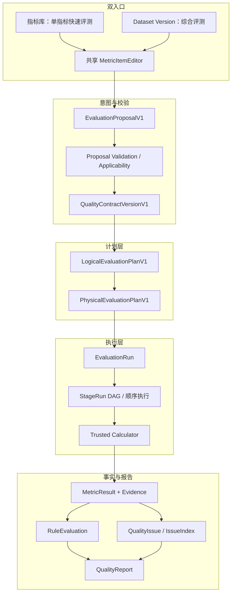
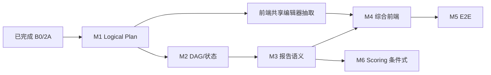

# 数据集维度综合质量评测开发计划

- 状态：待实施（基线闭环 0、1、1.5、2A 已完成）
- 更新日期：2026-10-28
- 目标：保留单指标快速评测，在同一 canonical 内核上补齐数据集维度的多指标计划、执行、报告与前端入口
- 依据：`docs/development/next-stage-agent-calculator-plan.md`、`plan/Idea-Pool/数据集维度综合评测.md`、当前源码与闭环 2A 验收记录

## 1. 文档定位与决策摘要

本计划不建设第二套评测平台。单指标评测是统一 Contract 中只有一个 item 的特例；综合评测从 Dataset Version 出发，人工选择多个合法 Metric/Calculator，经 Proposal 校验后发布多 item Contract，再进入统一 Plan、Run、Result、Rule、Issue 和 Report 链路。

推荐主线：

```text
已完成 2A：Applicability + Proposal Validation + 多指标 Contract
  → M1：身份与 Logical Plan
  → M2：Physical Plan 依赖 + 多 Stage 状态语义
  → M3：综合报告语义与下钻
  → M4：数据集综合评测前端
  → M5：真实 E2E 闭环
  → M6（条件满足后）：显式 Scoring Policy 与综合评分
```

关键决策：

1. V1 一个 Contract 内同一 `metric_key@version` 只允许一个 item；同一 Metric 多 Calculator 用不同 Run 做实现比较。在报告身份模型升级前，不允许在同一 Run 中混放。
2. Logical Plan 必须持久化；Physical Plan 是 Logical Plan 的不可变可执行映射。
3. V1 仍采用单进程顺序执行，但按 DAG 拓扑顺序调度，独立 Stage 互不阻塞。
4. 执行成功、规则 FAIL、指标不适用、输入缺失和执行 ERROR 保持不同语义。
5. “Contract 内计划项全部完成”不等于“指南指标体系完整覆盖”。
6. 没有明确权重、归一化与缺失策略时不生成综合分数；先交付覆盖、Gate、指标结果与下钻。

## 2. 范围与非范围

### 2.1 本阶段范围

- 保留现有单指标快速评测页面和 API。
- 从已发布 Dataset Version 创建人工多指标综合评测。
- 复用 `EvaluationProposalV1` 做校验预览，不要求本阶段持久化 Proposal。
- 增加 Logical Evaluation Plan。
- 扩展 Physical Plan、StageRun 和 Executor 的依赖、跳过和部分失败语义。
- 生成多指标、可解释、可下钻的 Quality Report。
- 增加 Dataset Version 侧的“创建综合评测”入口。
- 规划显式、版本化 Scoring Policy；只有满足前置条件时才启用评分。

### 2.2 明确排除

- Agent、Skill Runtime、LLM 自动推荐、SFT、GRPO。
- Proposal 推荐 Baseline 与 revision 持久化（属于闭环 2B）。
- 大规模新增 Metric/Calculator。
- 分布式调度、并行执行、Celery/Kafka/Airflow。
- 自动修复数据、自动发布 Contract 或自动启动 Run。
- 无标准依据的权重、归一化或“官方综合分”。

## 3. 当前真实基线

### 3.1 已实现并通过真实环境验收

| 能力 | 状态 | 真实实现 |
| --- | --- | --- |
| 多 item Contract canonical model | 已实现 | `QualityContractVersionV1.items`，`src/qa_eval/contracts/quality.py` |
| 多指标原子发布 | 已实现 | `QualityContractService.publish_multi`，`POST /api/v1/quality-contract-versions/multi` |
| 单指标兼容 | 已实现 | `QualityContractService.publish` 包装为单 item 多指标请求 |
| Applicability 四态 | 已实现 | `ApplicabilityService` 输出 `APPLICABLE / NOT_APPLICABLE / NEEDS_INPUT / UNAVAILABLE` |
| Proposal 校验 | 已实现 | `EvaluationProposalService.validate`，`POST /api/v1/evaluation-proposals/validate` |
| Calculator 插件加载 | 已实现 | `TrustedCalculatorLoader`、Calculator Protocol、Registry readiness |
| 代表性指标 | 已实现 | `0204`、`02080103`；后者有 exact-only 与完整版 Calculator |
| 多 Stage 顺序执行 | 部分实现 | `EvaluationRunService.create/execute` 已能为多 item 生成并执行多个 Physical Stage |
| 多 MetricResult 与 Report | 部分实现 | 真实双指标 Run 已生成两个 MetricResult 和一个 Report |
| Rule/Issue/IssueIndex | 已实现但 detector 有限 | Rule 为通用逻辑；Issue detector 目前只处理 `02080103` |

闭环 2A 已证明：同一 Contract 中 `0204` 与 `02080103` 可完成 Contract → Physical Plan → 2 StageRun → 2 MetricResult → 2 RuleEvaluation → Report。该能力是本计划起点，不再设置“恢复基线”里程碑。

### 3.2 尚未实现或仅部分实现

| 缺口 | 当前事实 | 影响 |
| --- | --- | --- |
| Logical Plan | 不存在；`EvaluationRunService.create` 直接编译 Physical Plan | 评测意图、适用性与物理实现缺少中间追溯层 |
| Stage 依赖 | `PhysicalStageV1` 没有 `depends_on` | 无法表达真实数据依赖和失败传播 |
| 拓扑校验 | 仅按 `order` 排序 | 无环检测、无依赖合法性检查 |
| StageRun 状态 | 仅 `PENDING/RUNNING/SUCCEEDED/FAILED` | 无法区分依赖跳过、不适用与缺失输入 |
| MetricResult 身份 | 结果关联 StageRun，但 Report 以 `(metric_key, version)` 建索引 | 同一 Metric 多 Calculator 会被折叠 |
| Report 覆盖语义 | 维度 total 来自本次 Contract 计划项 | `FULL_COVERAGE` 仅表示计划内完成，不能声称指南全覆盖 |
| 综合评分 | 无 scoring policy、score result 或权重来源 | 不能生成可信总分或雷达图 |
| 前端入口 | 只有指标库单指标入口 | 用户不能从 Dataset Version 发起综合评测 |

### 3.3 当前调用链


核心代码：

- Contract：`src/qa_eval/contracts/quality.py`、`src/qa_eval/application/services/quality_contract_service.py`
- Proposal/适用性：`src/qa_eval/contracts/proposals.py`、`evaluation_proposal_service.py`、`applicability_service.py`
- Plan/Run：`src/qa_eval/contracts/execution.py`、`evaluation_run_service.py`
- Result/Report：`rule_evaluator.py`、`quality_result_service.py`、`report_generator.py`
- 前端：`MetricRegistryPage.tsx`、`QualityContractBuilderPage.tsx`、`EvaluationResultsPage.tsx`

## 4. 双入口、统一执行内核

### 4.1 模式 A：单指标快速评测

保持现有入口，用于 Calculator 开发、专项检查和回归测试：

```text
Metric → Calculator → 参数/规则 → 单 item Contract → Run → 单指标 Report
```

### 4.2 模式 B：数据集综合评测

```text
Published Dataset Version
  → 人工添加多个 Metric
  → 每个 Metric 选择一个 Calculator、measurement、参数和规则
  → EvaluationProposalV1 校验预览
  → 用户确认
  → 多 item Quality Contract
  → Logical Plan → Physical Plan
  → Evaluation Run / 多 StageRun
  → 多 MetricResult / Rule / IssueIndex
  → 综合 Quality Report
```

### 4.3 目标架构



## 5. Contract 与身份不变量

### 5.1 复用现有 Contract，不新增明细表

`QualityContractVersionModel.document` 为 JSONB，`QualityContractVersionV1.items` 已支持多 item。无需新增 `ContractMetric` 表，也无需为多指标 Contract 增加 migration。

每个 item 已独立保存 Metric key/version/measurement、scope、Calculator key/version、parameters 和 rule。Calculator identity 当前位于 `implementation_constraints.attributes`。

### 5.2 V1 新增校验不变量

当前 Report 使用 `(metric_key, metric_version)` 建 `result_by_metric`，`QualityReportV1` 也要求 section 按 key/version 唯一。因此 V1 发布综合 Contract 时必须拒绝重复的 `metric_key@version`，即一个 Metric 只能选择一个 Calculator。

建议结构化错误：`DUPLICATE_METRIC_IMPLEMENTATION_NOT_SUPPORTED`。

同一 Metric 多 Calculator 的比较方式：发布两个 Contract/Run，以 Dataset Version、Metric、Calculator digest 和参数做并列比较。未来若确需同 Run 多实现，必须先升级：

- `MetricResult` 增加稳定的 `contract_item_key` 或 computation identity。
- Report 以 `contract_item_key`/`metric_result_id` 建 section。
- Rule、Issue、Report 全链路使用相同 identity。

### 5.3 Calculator 引用

V1 继续读取 `calculation.implementation_constraints.attributes.calculator_key/version`，避免无收益的 Contract schema 迁移；Logical Plan 编译时把它解析为强类型 `VersionedKey`，验证 Binding 并快照 descriptor digest。

中期可在 Quality Contract 下一主版本中显式增加 `implementation` 字段，但不得在同一 `1.0` schema 中维护两个语义来源。

### 5.4 原子性与兼容性

- 发布前校验所有 item；任一非法时整份 Contract 不写入。
- 单指标 POST 继续包装为一个 item。
- Contract 发布后不可变；Registry 变化不改写历史 Contract/Plan。
- Proposal 是草稿，不持有 Published、Contract ID 或 Run ID。

## 6. Logical Evaluation Plan V1

Logical Plan 表达“算什么、为何可计算、逻辑依赖是什么”，不包含 entrypoint、资源、临时目录或物理 URI。

建议新增 `src/qa_eval/contracts/plans.py`：

```python
class LogicalInputRequirementV1(WireModel):
    kind: str
    required: bool = True

class LogicalStageV1(WireModel):
    logical_stage_id: str
    contract_item_key: str
    metric: ContractMetricSelector
    scope: Literal["DATASET", "SAMPLE", "CONTENT", "ANNOTATION"]
    calculator: VersionedKey
    parameters: JsonObject
    required_inputs: list[LogicalInputRequirementV1]
    depends_on: list[str] = []
    applicability: ApplicabilityDecisionV1

class LogicalEvaluationPlanV1(WireModel):
    schema_version: Literal["1.0"] = "1.0"
    logical_plan_id: UUID
    dataset_version_id: UUID
    contract_version_id: UUID
    profile_fingerprint: str | None
    stages: list[LogicalStageV1]
    semantic_fingerprint: str
    created_at: datetime
```

新增 `EvaluationPlanCompiler`，职责：

1. 读取 Published Contract 与目标 Published Dataset Version。
2. 解析每个 item 的 Metric、Calculator、Binding。
3. 使用当前 Manifest/Profile/Registry 重新运行 Applicability，不能只信任旧 Proposal。
4. V1 默认仅将 `APPLICABLE` 编译为可执行节点；其他状态在创建 Run 前拒绝并返回 finding。
5. 每个 Contract item 生成一个 logical stage；没有真实依赖时 `depends_on=[]`。
6. 校验 stage ID 唯一、依赖存在、无自依赖、DAG 无环。
7. fingerprint 覆盖 Contract fingerprint、Dataset/input fingerprint、Profile fingerprint、Registry identity、参数和依赖。

持久化新增 `logical_evaluation_plans`：logical plan ID、dataset version ID、contract version ID、semantic fingerprint、document JSONB、created_at。`physical_evaluation_plans` 增加过渡期 nullable 的 `logical_plan_id` FK；新 Run 必填。

## 7. Physical Plan V1.1

扩展 `PhysicalStageV1`：

```python
class PhysicalStageV1(WireModel):
    stage_id: str
    logical_stage_id: str
    contract_item_key: str
    order: int
    metric: VersionedKey
    calculator: JsonObject
    resolved_parameters: JsonObject
    input_schema_ref: str
    output_schema_ref: str
    depends_on: list[str] = []
    input_bindings: JsonObject = {}
    output_bindings: JsonObject = {}
    timeout_seconds: int | None = None
```

物理编译器负责解析受信任 descriptor、默认参数和语义参数，固化 entrypoint/code digest/runtime/timeout/schema，生成稳定 stage ID、拓扑 order 与依赖映射。

V1 不实现共享 feature producer、缓存或并行调度，只预留 bindings。

## 8. 多 Stage 执行与状态语义

### 8.1 StageRun 与 MetricResult

StageRun 扩展：`SKIPPED_DEPENDENCY / NOT_APPLICABLE / MISSING_INPUT`。

| StageRun | MetricResult | RuleEvaluation |
| --- | --- | --- |
| SUCCEEDED | OK | PASS 或 FAIL |
| FAILED | ERROR | UNKNOWN/SKIPPED，`METRIC_ERROR` |
| SKIPPED_DEPENDENCY | MISSING | UNKNOWN/SKIPPED，`METRIC_MISSING` |
| MISSING_INPUT | MISSING | UNKNOWN/SKIPPED，`METRIC_MISSING` |
| NOT_APPLICABLE | NOT_APPLICABLE | UNKNOWN/SKIPPED，`NOT_APPLICABLE` |

Rule FAIL 不改变 StageRun/Run 的执行成功状态。

### 8.2 调度与失败传播

1. Plan 创建时拓扑排序并检测环；执行时防御性复核。
2. 按拓扑 order 单线程执行。
3. 独立 Stage 即使前一个失败也继续执行。
4. 必需依赖失败才跳过下游；可选依赖缺失不自动跳过。
5. 每个计划 Stage 最终产生一个 StageRun 和一个 MetricResult，包括跳过/不适用。
6. V1 不做原地重试；重新运行创建新的 Evaluation Run。

### 8.3 Run 最终状态

- 全部 SUCCEEDED：`SUCCEEDED`。
- 至少一个成功，另有 FAILED/MISSING/SKIPPED：`PARTIAL_SUCCEEDED`。
- 无成功且至少一个执行失败：`FAILED`。
- 全部 NOT_APPLICABLE/MISSING_INPUT：优先新增 `COMPLETED_WITHOUT_RESULTS`；若暂不扩展，则使用 `PARTIAL_SUCCEEDED` 并明确原因，不能标为 SUCCEEDED。

## 9. 综合报告：先可信覆盖，再条件化评分

### 9.1 已有能力

`build_quality_report` 已能汇集多个 MetricResult，展示 Contract measurement/diagnostics，关联 RuleEvaluation、IssueIndex、Evidence IDs，并汇总 Gate、Issue 和结果状态。

### 9.2 覆盖语义

当前 `ReportDimension.total_metric_count` 来自 Contract，不是指南全量指标。应将现有语义明确为 `planned_coverage`：planned、evaluated、not_applicable、missing、error 和 completion ratio。

若展示指南覆盖，另建 `benchmark_coverage`：benchmark key/version/fingerprint、适用指标总数、已评测/未评测/不适用数量。在 benchmark catalog 未建立前，只显示“本次计划执行覆盖”，不得显示“数据质量维度完整覆盖”。

### 9.3 指标身份与下钻

每个 section 必须可追溯 contract item、logical/physical stage、Metric version、Calculator key/version/digest、参数 fingerprint、observation、Rule、Evidence 和 execution/applicability status。若暂不升级 Report schema，这些字段至少通过关联 API 可查询；前端不能靠 Metric key 猜 Calculator。

综合报告不要求每个 Metric 都生成逐样本 Issue。`0204` 已有 `MISSINGNESS` evidence，可先完成证据下钻。是否生成逐样本 Issue 需先确定数量上限、severity 与 Contract rule 关系，不能默认制造海量 Issue。

### 9.4 Scoring Policy 前置条件

禁止用 `MetricMeasurement.minimum/maximum` 自动归一化；它们是合法取值范围，不是质量评分锚点。禁止把不同单位 observation 直接相加或平均。

只有存在显式 `ScoringPolicyV1` 时才评分：

```python
class MetricScoreRuleV1(WireModel):
    contract_item_key: str
    method: Literal["RULE_OUTCOME", "PIECEWISE_LINEAR"]
    weight: float
    anchors: list[ScoreAnchor] = []

class ScoringPolicyV1(WireModel):
    key: str
    version: str
    source: str
    dimension_weights: dict[str, float]
    metric_rules: list[MetricScoreRuleV1]
    not_applicable_policy: Literal["EXCLUDE"]
    missing_policy: Literal["NO_SCORE", "PARTIAL_SCORE"]
    fingerprint: str
```

要求：权重、方向、锚点和缺失策略可验证；policy identity/fingerprint 固化到 Contract/Plan/Report；NOT_APPLICABLE 不进分母；ERROR/MISSING 默认 NO_SCORE；输出 `FULL/PARTIAL/UNAVAILABLE` score status。没有 policy 时 `overall_score=None`。

## 10. 报告下钻

```text
QualityReport
  → planned dimension/metric section
  → MetricResult
  → RuleEvaluation / IssueIndex
  → Evidence Artifact
  → SampleRecord（证据包含 sample_id 时）
```

已有 `EvaluationResultsPage`、`QualityResultService.list_issues(metric_result_id=...)`、`get_sample_by_id` 和前端 `viewSample`。需补齐 Report section 到 Contract item/Calculator/StageRun 的稳定关联、Evidence artifact 浏览/下载接口、非 sample evidence 展示，并继续遵守 evidence redaction policy。

## 11. 前端方案

当前 `App.tsx` 使用本地 view state，不是 URL Router。V1 可沿用该方式增加综合评测 draft state，避免同时迁移路由系统。

先从 `QualityContractBuilderPage` 抽取共享 `MetricItemEditor`：Metric/measurement、Calculator、JSON Schema 参数、rule 与 item-level findings。单指标和综合页面共同使用，不能复制默认参数和校验逻辑。

综合 Wizard：

```text
1. Dataset Version 摘要与 Profile fingerprint
2. 添加 Metric（禁止重复 metric_key@version）
3. 每个 Metric 配置一个 Calculator、参数和规则
4. 调用 /evaluation-proposals/validate
5. 展示四态 finding；仅全部 APPLICABLE 且 valid 时允许确认
6. 用户确认后调用 /quality-contract-versions/multi
7. 创建 Run，显示 Stage 进度
8. 跳转综合 Report
```

修改/新增：

- `apps/web/src/api/evaluationProposals.ts`
- `apps/web/src/api/qualityContracts.ts` multi publish
- `DatasetComprehensiveEvaluationPage.tsx`
- `MetricItemEditor.tsx`
- `App.tsx` view state
- `DatasetDetailPage.tsx`、`DatasetVersionPage.tsx` Published Version 入口

报告首版展示 Run/Gate、本次计划覆盖、item execution/applicability/rule、observation/diagnostics/Evidence/Issue。仅当后端返回 ScoringResult 时显示分数或雷达图；前端不得自行归一化、加权或补零。

## 12. 数据库与 API 变更

### 12.1 必需 migration

| 变更 | 兼容策略 |
| --- | --- |
| 新建 `logical_evaluation_plans` | 新表，不影响旧数据 |
| `physical_evaluation_plans.logical_plan_id` | 过渡期 nullable；新 Run 必填 |

StageRun 新状态使用现有 `String(32)` 与 JSONB，无需列类型迁移。Plan/Report 新字段必须版本化 canonical schema 并重新生成 checked-in JSON Schema。

### 12.2 API

- 保留 `POST /api/v1/quality-contract-versions`
- 保留 `POST /api/v1/quality-contract-versions/multi`
- 保留 `POST /api/v1/evaluation-proposals/validate`
- 扩展创建 Run：原子持久化 Logical/Physical Plan
- 新增 `GET /api/v1/evaluation-runs/{run_id}/logical-plan`
- 保留/扩展 `GET /api/v1/evaluation-runs/{run_id}/stage-runs`
- 新增或扩展 Evidence 读取 API

不增加综合评测专用执行 API。

## 13. 里程碑

每个里程碑必须通过完整 pytest、Ruff、schema drift、前端 lint/build，并按统一门禁完成真实 PostgreSQL/ArtifactStore 新 Contract/Run 冒烟。

### 基线 B0：已完成，不重复开发

- 闭环 0、1、1.5、2A 已完成。
- 多指标 Contract、Proposal Validation、双 Stage Run、双 MetricResult、Report 已真实验证。
- 下一步不是恢复 schema，而是补 Logical Plan 与身份不变量。

### M1：Contract 身份加固 + Logical Plan

- **目标**：建立逻辑计划，消除同 Metric 多实现折叠风险。
- **修改**：Contract service 增加重复 Metric 拒绝；新增 `contracts/plans.py`、Plan Compiler、Logical Plan ORM/migration/schema；Physical Plan 增加 logical ID；Run service 委托 compiler。
- **测试**：单 item、两个独立 Metric、重复 Metric 拒绝、Profile/Registry 变化、环/悬空/自依赖拒绝、旧 Plan 读取。
- **完成标准**：每个新 Run 同时持久化 Logical/Physical Plan；Stage 可追溯 Contract item；真实双指标 Run 成功。
- **回滚**：保留旧 plan reader；nullable logical FK 允许回退旧路径。

### M2：Physical DAG + 状态语义

- **目标**：正确执行独立/依赖 Stage，表达部分失败和跳过。
- **修改**：`contracts/execution.py`、`evaluation_run_service.py`、rule evaluator、schemas/API。
- **测试**：双独立 Stage；受信任测试 Calculator 在 execute 阶段抛错但另一个 Stage 继续；依赖失败后下游跳过；Rule FAIL 但执行成功；全 NOT_APPLICABLE/MISSING。
- **注意**：不能用错误 entrypoint 制造执行期失败，因为 Loader 在 Run 创建前拒绝。
- **完成标准**：每个计划 Stage 有终态 StageRun/MetricResult；独立失败不传播；Report 正确反映 partial execution。

### M3：综合报告语义与下钻

- **目标**：报告完整表达多指标事实，不制造误导覆盖或总分。
- **修改**：QualityReport model、report generator、QualityResultService、Evidence API、EvaluationResultsPage。
- **交付**：planned/benchmark coverage 分离；item/Calculator/Stage 可追溯；混合状态与 Evidence 下钻；无 policy 时明确 NOT_SCORED。
- **测试**：OK/FAIL/NOT_APPLICABLE/MISSING/ERROR 混合报告；Evidence/Sample 下钻；敏感 evidence 不泄露原文。
- **完成标准**：页面不把计划完成解释成指南全覆盖；无 policy 不展示总分。

### M4：综合评测前端

- **目标**：从 Published Dataset Version 完成人工综合评测全流程。
- **修改**：共享 MetricItemEditor、综合 Wizard、API client、Dataset Version 入口和 App view state。
- **完成标准**：用户可配置 `0204 + 02080103`，查看 finding，确认发布，创建 Run并进入综合 Report；单指标流程不变。

### M5：完整 E2E 与发布门禁

- Case A：单指标 `02080103` 回归。
- Case B：`0204 + 02080103` 无依赖双指标成功。
- Case C：独立 Stage 部分失败，Run/Report 部分成功且无完整评分。
- Case D：依赖失败传播。
- Case E：维度 → item → Result/Rule/Issue/Evidence → Sample 下钻。
- Case F：文本 Dataset 的测试图像候选为 NOT_APPLICABLE 且不进入正式 Contract。
- **完成标准**：自动化门与真实 PostgreSQL/ArtifactStore 新 Contract/Run/Report 冒烟通过，验收 ID 写入 `docs/progress/`。

### M6：Scoring Policy（条件式）

- **前置条件**：用户或标准提供明确权重、评分锚点、方向、缺失与不适用策略。
- **目标**：版本化、可审计地生成指标/维度/总体分数。
- **修改**：新增 scoring contracts/service；Contract/Plan 固化 policy fingerprint；Report 增加 ScoringResult。
- **完成标准**：相同事实和 policy 得到确定性相同分数；无 policy 时不评分。
- **若前置缺失**：M6 不启动，不阻塞 M1-M5。

## 14. 依赖与并行关系



允许并行：M1 接口稳定后并行抽取前端共享编辑器；M3 的 Evidence API 与报告 UI 可在 schema 冻结后并行。

必须顺序：Logical identity → Physical DAG → 混合状态 Report；Scoring 晚于报告状态/覆盖语义和评分政策确认。

## 15. 测试与统一验收标准

### 15.1 Contract/Plan

- 单指标 Contract 兼容；多 item 发布原子。
- 重复 Metric implementation 在 V1 被拒绝。
- Logical/Physical fingerprint 覆盖所有语义输入。
- 环、悬空依赖、自依赖在创建 Run 前拒绝。

### 15.2 Runtime

- 每个 Plan Stage 最终有 StageRun 和 MetricResult。
- Calculator ERROR 不变成 Rule FAIL；Rule FAIL 不变成 StageRun FAILED。
- NOT_APPLICABLE、MISSING、ERROR 不按零分处理。
- 独立 Stage 继续执行；依赖 Stage 正确跳过。

### 15.3 Report/UI

- Report 展示 Contract item 与 Calculator identity。
- planned coverage 与 benchmark coverage 不混淆。
- 无 policy 不生成总分/雷达图。
- Issue/Evidence/Sample 引用可核对。
- 前端不计算规则、覆盖或分数。

### 15.4 质量门

- 完整 pytest 通过或仅保留明确环境跳过。
- Ruff、schema drift、前端 lint/build 通过。
- Alembic 单一 head，当前 Registry readiness 通过。
- 使用已发布 Dataset Version，新建 Contract Version 和 Run，成功读取 Report。

## 16. 风险与延后事项

| 风险/技术债 | 处理 |
| --- | --- |
| Logical Plan 在无依赖阶段看似冗余 | 保持最小字段，但作为 Contract/Physical 追溯边界落地 |
| 同 Metric 多 Calculator 折叠 | V1 禁止同 Contract 重复 Metric；协议升级后开放 |
| Calculator identity 位于弱类型 attributes | Logical compiler 强类型解析；后续 Contract 主版本显式化 |
| 0204 可能产生海量 Issue | 先 Evidence 下钻；detector 另行确定上限和策略 |
| FULL_COVERAGE 容易误导 | 明确 planned coverage；benchmark coverage 独立建模 |
| 缺少官方评分规则 | 默认 NOT_SCORED，M6 条件式启动 |
| 顺序执行吞吐有限 | 正确性优先，保留 DAG 供未来并行化 |

延后：Agent/Skill Runtime、Proposal 持久化、规则推荐 Baseline、缓存/共享特征、分布式执行、LLM-assisted Calculator。

## 17. 推荐首先实施的开发步骤

第一个开发 Milestone 是 **M1：Contract 身份加固 + Logical Plan**：

1. 增加重复 `metric_key@version` 拒绝测试与校验。
2. 定义 `LogicalEvaluationPlanV1` / `LogicalStageV1` 及 checked-in schema。
3. 实现纯函数式 Plan Compiler，覆盖 fingerprint、DAG 与 applicability 测试。
4. 新增 Logical Plan ORM 与单一 Alembic migration。
5. 让 `EvaluationRunService.create` 委托 compiler，原子持久化 Logical/Physical Plan/Run。
6. 用 `0204 + 02080103` 完成自动化与真实环境新 Run 验收。

M1 完成后再进入 M2；不要同时实现评分、复杂前端或 Agent。
