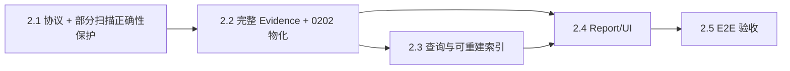

# Phase 2：分阶段实施与验收计划

> 优先级：先完成 0202 Record/Content 的真实闭环；Pair/Group/Dataset 完成协议与关键测试。所有阶段均可独立开关和回滚。

## 1. 依赖与顺序

正确性依赖与性能依赖分开：2.1、2.2 是 0202 Builder 上线前置；2.3 是查询性能增强，不阻塞 MetricResult 持久化，也不阻塞 Builder 对 Artifact 的一次流式物化。若没有 2.3，只能在受控小文件上降级查询，大文件 UI 下钻保持不可用/构建中，而不是反复全量扫描。

## 2. Phase 2.1：Evidence 与 Issue 关联机制

目标：建立 row identity、locator 规范、Reader/Builder Registry；完成部分扫描总体判定的最小保护；保持 0208 行为不变。

依赖：现有 MetricResult、EvidenceArtifact、QualityIssueV1 与 ArtifactStore。

修改文件：

- 新增 `src/qa_eval/application/evidence/readers.py`（索引延后到 2.3）；
- 新增 `src/qa_eval/application/issues/{protocol,registry,generic_threshold,duplicate_group}.py`；
- 修改 `quality_result_service.py`，只负责编排 Builder；
- 最小修改 Calculator result/status 或 `rule_evaluator.py` 的覆盖守卫，确保非总体覆盖的全局规则为 UNKNOWN/SKIPPED；
- 可选新增 Evidence location JSON Schema；QualityIssue 1.0 仍保持兼容；
- 单元测试新增 Builder 匹配、legacy reader、dedup、checksum 和流式读取测试。

步骤：定义 `EVIDENCE_ROW/1.0` locator → 实现 legacy row_id 派生 → 实现记录总体覆盖判定 → RuleEvaluator 比较前应用覆盖守卫 → 包装 0208 Builder → 完整计算后事务级差异 upsert → feature flag shadow diff。无 API/UI 变化。

验收：同一输入重复 finalize 不增加 Issue且保留原 issue_id/status/created_at；Builder 失败零写入；并发 finalize 最终只有一个 dedup 集合；0208 snapshot 完全一致；未知 schema 不猜定位；10 万行 Evidence 峰值内存有界。0202 前 20/总体、扫描失败、不可解析内容等情况的比例/计数规则均为 UNKNOWN/SKIPPED，局部 Issue 仍可保留；只有显式单调存在性规则才允许局部事实提前 FAIL，本轮无声明时一律不启用。

风险/回滚：注册错误可能漏 Issue；开关切回旧 `_issues_for_result`。迁移期禁止新旧 Builder 同时物化。

## 3. Phase 2.2：0202 记录级问题物化

目标：完整流式持久化 0202 Evidence，按 sample/content/category 聚合并生成可解释的 CONTENT/SAMPLE CANDIDATE Issue；若只能截断，则以受控不完整模式降级。

依赖：2.1；0202 Evidence schema 和 completeness 元数据。

修改文件：

- 新增 `application/issues/sensitive_entity.py`；
- 修改 0202 Calculator，仅补 row_id/text_version/完整性属性及取消持久化硬截断（算法不变）；
- 更新对应 schema、Calculator 单元测试、Run 集成测试和 QualityResult 测试。

Schema：Evidence 行新增可选公共信封字段；历史字段继续输出一个过渡版本或由 Reader 适配。Issue 本体不新增必填字段。

步骤：取消持久化硬截断并保持逐行文件写入/Executor 上传 → 为 0202/0204/0208 定义 schema-specific completeness validator → 实现 row reader → 定义类别中文文案/确认策略 → 聚合多 span → 生成稳定 dedup key → 防止 Dataset threshold 摘要重复计数 → 校验 Report summary。

测试：同记录多 span、不同 category、HTML visible/plain/title、NER+RULE、纯规则、UNREVIEWED、Evidence 缺 content_id、截断历史产物、PARTIAL result；500 detected/500 emitted 完整模式、500/100 截断降级；0208 group count 不与成员异常数错误比较；Builder 中途失败、Artifact 暂不可用、未知 schema、Builder 版本变化及已有非 OPEN Issue 状态保护。

验收：模拟 3 命中/2 Record 得到正确受影响记录数，Record B 多行证据聚合；默认 UNREVIEWED 为 CANDIDATE；不泄露原始手机号/身份证号；Metric measurement 不被改写。报告分别给出 detected facts、persisted Evidence records、materialized Issues、affected Records、Evidence completeness 和 Issue-detail completeness。正式启用前必须满足 A（完整持久化且 COMPLETE，推荐）或 B（INCOMPLETE/UNKNOWN 明示，禁止作为全量清单）；并确认 2.1 覆盖守卫已启用。

风险/回滚：Evidence 全量持久化增大对象；可临时启用“截断但显式 incomplete”模式，关闭 0202 Builder 后回到 Dataset Issue。

## 4. Phase 2.3：Evidence 查询与原文定位

目标：Issue → Evidence row → SampleRecord → field/span 在常量级/对数级索引访问下完成。

依赖：2.1 row_id、2.2 稳定 Evidence schema；Artifact Store 支持物化，S3 环境确认 Range Read 能力。它不是 MetricResult/Issue 正确持久化依赖。

修改文件：

- 新增 `EvidenceQueryService`、`ArtifactRecordIndexService`；
- 扩展 ArtifactStore（可选 `read_range`，保留 materialize fallback）；
- 新增 quality-results Evidence/locations 路由；
- `get_sample_by_id` 改用 sample offset index；
- 新增索引 Artifact metadata/DB 引用迁移时，明确其为技术索引而非业务模型。

步骤：实现 `NOT_BUILT/BUILDING/READY/FAILED/STALE` 技术 metadata → 以 artifact_id+checksum 幂等触发并用租约去重并发构建 → 为未压缩 normalized/evidence JSONL 构建 offset index → READY 查询前校验 source checksum → 实现失败退避/失效重建/级联清理/历史补建 → 实现 cursor 查询和过滤 → 实现 code-point/UTF-16 转换 → visible text 版本校验 → 权限/审计/脱敏。

性能测试：321,902 条量级生成索引；随机查询 P50/P95；Local 与 S3；索引冷/热、失效、Artifact 缺失；并发 Issue drawer。建议验收门槛：索引热查询服务端 P95 < 200 ms（不含网络 UI 渲染），单次查询不扫描全文件、不下载整个 S3 对象。

功能测试：同 sample_id 跨 Dataset Version 不串读；emoji/扩展字符坐标转换；span 越界/text checksum 不符降级；gzip Artifact 明确 fallback；Pair/Group 多记录查询；五态转换、并发构建去重、checksum STALE、FAILED 重试、源删除清理。验证任何索引失败都不改变 MetricResult/Run。

风险/回滚：S3 Range、压缩和索引生命周期。关闭索引路由时，小 Artifact 可退回线性扫描，大 Artifact 返回明确不可用，避免拖垮服务。

## 5. Phase 2.4：报告与前端展示

目标：指标、Issue、Evidence、Record 四级下钻，并分开显示三个统计口径。

依赖：2.2、2.3。

修改文件：

- `contracts/quality.py`/report generator：只增加可选 `traceability_summary`（如采纳）；
- `apps/api/routes/quality_results.py`；
- `apps/web/src/api/*`、`EvaluationResultsPage.tsx` 及 Issue/Evidence/Record drawer 组件；
- 前后端契约与组件测试。

步骤：指标卡传 metric_result_id → Issue cursor page → Evidence drawer → 定位 API → 根据 coordinate space 选 viewer → Pair/Group 标签页 → 技术详情折叠区。

验收：分别展示 detected facts、Evidence records、Issues、affected Records、Evidence/Issue-detail completeness；展示已扫描记录数、总体数、记录覆盖率、是否全量及规则结论是否适用于总体，字符扫描完整度不得冒充记录覆盖率。INCOMPLETE/UNKNOWN 禁止“全部问题”文案；敏感片段始终脱敏；HTML 安全渲染；历史 Report 无新增字段也可打开；定位失败仍能查看 Issue。

风险/回滚：大列表和富文本渲染；使用分页/虚拟化，feature flag 隐藏新 drawer，不影响旧报告页。

## 6. Phase 2.5：端到端测试与验收

目标：用小型固定政策 fixture 覆盖完整链路，不运行 321,902 条付费/大规模评测。

测试矩阵：

| 类别 | 必测内容 |
| --- | --- |
| 0202 E2E | Contract → Plan → Run → MetricResult → Rule → multiple Issues → Evidence → visible span |
| Record | 多 span 聚合、字段降级、跨版本隔离 |
| Pair | pair_id 规范排序、双方 evidence、related subjects |
| Group | group signature、成员顺序无关、0208 回归 |
| Dataset | 无记录证据时的 measurement locator |
| 完整性 | schema-specific 校验；0202 detected/emitted 一致；0208 group/member 口径；截断与历史 UNKNOWN |
| 幂等 | 稳定 dedup、完整计算后差异 upsert、事务失败零部分写、并发、issue_id/status 保留 |
| 状态 | 部分发现候选/确定性异常、未发现、样本比例、失败记录、不可解析内容的判定矩阵 |
| 性能 | 32 万量级索引、随机读、并发、S3 range |
| 安全 | 脱敏、权限、审计、HTML XSS、Artifact URI 隐藏 |
| 历史兼容 | legacy locator、无 row_id、无 completeness、旧 Report |

发布顺序：覆盖判定守卫与 Builder 协议 → 0202 完整性/全量 Evidence → Builder shadow diff → 0202 Builder → 只读 Evidence API/offset index → Report/前端下钻。不得把 PARTIAL 保护留到末尾。每步观察四类计数、完整性状态、Issue 差异、索引状态、查询延迟和 4xx/5xx。

最终验收：用户从 0202 指标在不接触技术 ID 的主流程中定位到某政策记录的具体可见文本 span；多 Evidence 正确聚合；坐标不可靠时不虚构高亮；所有统计口径可解释；旧报告不回填、不损坏。

## 7. 文件级总清单

| 层 | 预计修改 |
| --- | --- |
| Contract/Schema | `contracts/metrics.py`（可选字段）、Evidence location schemas、`contracts/quality.py`（可选 report summary） |
| Calculator | 0202 仅补稳定引用、文本版本和完整性；不改检测算法 |
| Application | Evidence readers/index/query；Issue Builder protocol/registry/0202/0208；QualityResultService 编排 |
| Infrastructure | Phase 2.3 才增加 Artifact range read/offset index；必要的技术索引 metadata/目录 |
| API | quality issue detail、Evidence metadata/rows、Issue evidence/locations；sample API 索引化 |
| Web | EvaluationResultsPage 下钻、Evidence drawer、Record viewer、Pair/Group 切换 |
| Test | unit、integration、API、web、performance、historical fixtures |

## 8. 后续项（不作为本轮前置）

- Planner 统一 sampling strategy、分层/随机抽样和 checkpoint；
- 多 Calculator 共享 Record Stage 与跨 Run Artifact 缓存；
- raw HTML ↔ visible text 字符映射或 DOM path；
- 分片 JSONL、seekable compression、Parquet/专用检索存储；
- 全量人工复核工作流及 Issue 状态更新 API；
- 0202 v2 正式评分映射与运营 Profile 版本匹配；
- Pair/Group 专属前端高级交互。

## 9. 未决风险与阻塞判断

未决决策包括：Evidence index 选 SQLite 还是 JSONL、S3 Adapter 是否增加 range API、未来人工复核状态的权威来源、纯确定性规则允许自动 CONFIRMED/单调存在性规则声明的治理配置位置。索引决策可延后至 2.3；在没有自动确认/单调性声明时保守使用 CANDIDATE 与 UNKNOWN，因此不阻塞 2.1。

不存在阻塞 Phase 2.1 开发的未决架构问题。0202 Builder 的上线门槛是：不得在 `evidence_limit` 截断时宣称完整溯源；不得把局部扫描的聚合结果展示成总体规则结论；重建不得覆盖已有状态或产生部分集合。若短期无法全量持久化，应以 `INCOMPLETE/PARTIAL + UNKNOWN` 明确降级。高性能索引、S3 Range、Pair/Group 高级 UI 可延后，不扩大为调度体系重构。
