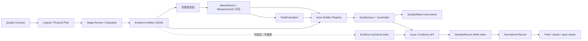

# Phase 2：评测结果溯源技术架构设计

> 设计日期：2026-11-11
>
> 输入：`docs/plan/Idea-Pool/评测结果模块/Phase1-现状审计与根因分析.md`、当前源码与 `data/政务数据集/policy.policy.jsonl` 只读核验
>
> 范围：仅技术方案，不修改业务代码、Registry、数据库或运行数据。

## 1. 结论与目标

现有链路不缺少记录级检测事实：Calculator 已把 Measurement 与 Evidence 分开输出，Evidence Artifact 经 Executor 写入 Artifact Store，MetricResult 保存其元数据。断点位于 Evidence 到 QualityIssue 的物化和查询层。推荐在现有 `QualityResultService` 前增加可注册的 **Issue Builder 策略层**，以版本化 Evidence schema 解析证据行，直接生成现有 `QualityIssueV1`；不新增 Finding 或平行业务实体。

本轮首要闭环是：

`0202 MetricResult → 0202 Evidence JSONL 行 → SAMPLE/CONTENT QualityIssue → Evidence 行查询 → SampleRecord → 字段/可见文本 Span 高亮`

Pair、Group、Dataset 复用同一协议；本轮完成契约和测试，专属交互可增量落地。Report 只保存汇总与 ID，不内联高基数证据。

## 2. 当前政策数据事实

对 `policy.policy.jsonl` 的只读核验结果：文件为 321,902 行 JSONL；每行是一篇政策/政务文章，`iid` 是业务记录标识，`title` 是标题，`content` 是 HTML 正文，另含 `policyurl`、发布时间、机构、文号等字段。不能沿用 Phase 1 案例中的历史 Run ID 或将其他数据集规模当作运行事实。

`configs/mapping_templates/policy.policy.json` 将 `iid` 映射为 `sample_id`，将 `content` 同时映射为：

- `article.body.html`：保留 HTML；
- `article.body.plain`：经 `html_to_complete_plain_text` 转换；
- `title` 映射为 `article.title`；
- SampleRecord 的 `source.source_artifact_id/source_record_id/source_row` 保留源定位，且每条 SampleRecord 带 `dataset_version_id`。

0202 Calculator 优先选择 `article.body.html`，缺失时回退 `article.body.plain`，并另扫 `article.title`。HTML span 是抽取后的可见文本 Unicode code point 坐标，不是 raw HTML、DOM、UTF-8 byte 或 JavaScript UTF-16 坐标。

## 3. 复用边界

| 现有对象 | 保留职责 | 本轮变化 |
| --- | --- | --- |
| MetricObservation / MetricResult | 数值、总体、覆盖率、Evidence 元数据 | 不承载异常明细；补充 Evidence 完整性元数据 |
| EvidenceOutput / EvidenceArtifact | 高基数检测事实与 Artifact 元数据 | 统一最小定位字段和稳定行引用 |
| RuleEvaluation | 判断 Measurement 是否满足 Contract | 不认定单条业务违规 |
| QualityIssueV1 | 可治理问题、对象、证据、状态 | 规范 locator；由 Builder 生成多条记录级 Issue |
| IssueIndex | Issue 的查询/导出索引 | 保持；不兼作 Evidence 索引 |
| QualityReport | 汇总、覆盖、规则与 Issue 数量 | 增加统计口径/限制说明，不内联证据行 |
| SampleRecordV2 | 标准化原文、source 与 lineage | 以 Dataset Version + sample_id 查询并校验版本 |

## 4. 目标数据流



这里存在两条可靠性要求不同的链路：

1. **事实持久化链路（强一致）**：Calculator 以现有有界内存方式把 Evidence 写入输出文件，Executor 将 Artifact commit 到 ArtifactStore，校验 checksum、size、record count 等必要完整性后，即可按现有事务保存引用它的 MetricResult。`Evidence Artifact 持久化 → MetricResult 可见` 不等待任何查询索引。
2. **查询加速链路（最终一致）**：已提交 Evidence/Normalized Artifact 触发可重建技术索引。索引失败、缺失或重建不改变 MetricResult、Evidence 或 Run 状态；只改变查询能力和延迟。`Artifact → technical index → 高效查询` 可以在提交后异步或首次查询时进行。

Issue Builder 从已持久化事实生成 Issue；Report 仍只从已持久化 Result、Rule、Issue、IssueIndex 聚合。Evidence technical index 不是事实权威源，也不是 Issue Builder 正确运行的必要条件：Builder 可顺序流式读取一次 Artifact，但在线查询不得对大文件反复这样做。

## 5. Evidence → QualityIssue 机制

### 5.1 方案比较

| 方案 | 优点 | 问题 | 结论 |
| --- | --- | --- | --- |
| 在 `QualityResultService` 继续 `if metric_key` | 修改少 | 专属解析持续堆积，难测试/版本化 | 不推荐 |
| Evidence schema 全通用映射 | 少量代码覆盖多指标 | 无法表达确认策略、聚合和业务文案差异 | 仅作通用兜底 |
| 可注册 Issue Builder | 版本化解析、独立测试、兼容复杂聚合 | 新增一个轻量策略接口 | 推荐 |

Builder 是应用层策略，不持久化，不是业务模型。注册键使用 `(metric_key, metric_version, evidence.kind, schema_ref)`；没有专属 Builder 时，仅允许生成有明确 Evidence 支撑的 Dataset threshold Issue，或空 IssueIndex，绝不能猜测记录级定位。

建议接口：

```python
class IssueBuilder(Protocol):
    key: str
    version: str
    def supports(self, result: MetricResultV1, evidence: EvidenceArtifact) -> bool: ...
    def build(self, context: IssueBuildContext) -> Iterable[QualityIssueV1]: ...
```

`IssueBuildContext` 只是进程内参数集合，包含 Result、相关 RuleEvaluation、Evidence 流、Contract severity 和生成时间；不得持久化为 Finding。Builder 必须流式读取，校验 checksum/schema/dataset version，并返回确定性 `dedup_key`。

### 5.2 三种语义严格分开

- 检测事实：Evidence 行，例如某字段某 span 命中手机号规则；可以是候选。
- 规则判定：RuleEvaluation 对聚合 Measurement 做 PASS/FAIL/UNKNOWN/SKIPPED。
- 业务认定：QualityIssue 的 `CANDIDATE/CONFIRMED`。只有确定性规则且发布政策明确把该事实定义为违规，或人工复核通过，才可 CONFIRMED。

| 场景 | Issue 行为 |
| --- | --- |
| FAIL，无可靠记录 Evidence | 生成一个 Dataset Issue；locator 只含 measurement/rule；不得声称定位全部记录 |
| FAIL，有记录 Evidence | 由 Builder 生成记录级 Issue；可另保留一个“阈值失败摘要”但标记 `summary_only=true`，报告统计不得重复计数；MVP 推荐不再创建摘要 Issue |
| Evidence 候选，Rule PASS/SKIPPED | 可生成 CANDIDATE Issue，来源的 `rule_evaluation_id` 可空；不改变 Gate |
| PARTIAL 且有命中 | 保留局部 CANDIDATE/确定性局部 CONFIRMED，UI 明示仅覆盖已扫描范围；全局规则应 UNKNOWN/SKIPPED |
| 待复核命中 | CANDIDATE；人工状态变化不通过重新跑 Builder 冒充确认 |
| 多行支持同一异常 | 聚合为一条 Issue，evidence 中列多个稳定行引用 |

### 5.3 部分扫描的总体判定保护（0202 Builder 上线前置）

执行成功、扫描覆盖和规则可判定性是三个独立维度。`MetricResult.status=OK` 只能说明 Calculator 正常返回，不能证明覆盖总体。最小修复优先利用 `population`、`semantic_coverage` 与 `status_detail.partial_scope`：只要目标总体未完全扫描、存在采样排除或扫描失败，就将结果表达为 PARTIAL（或由 RuleEvaluator 将总体规则降级为 UNKNOWN/SKIPPED）；不得继续用字符扫描完整度代替记录覆盖率。

| 扫描事实 | 局部 Issue | 总体规则结论 |
| --- | --- | --- |
| 部分扫描发现疑似命中 | CANDIDATE，可展示覆盖范围 | 比例/计数阈值 UNKNOWN/SKIPPED |
| 部分扫描发现确定性异常 | 可生成局部 CONFIRMED（仅当自动确认政策允许） | 默认 UNKNOWN；仅“存在一条确认违规即失败”的显式单调存在性规则可提前 FAIL |
| 部分扫描未发现异常 | 无 Issue | 不得 PASS，UNKNOWN/SKIPPED |
| 部分扫描得到异常比例 | 标注为样本观察 | 不得当作总体比例，UNKNOWN/SKIPPED |
| 扫描中有失败记录 | 已成功记录的局部 Issue可保留 | PARTIAL；总体 UNKNOWN/SKIPPED |
| 全量记录遍历完成但部分内容不可解析 | 可解析部分 Issue可保留 | 取决于 Contract 是否允许该排除；默认 PARTIAL/UNKNOWN |
| 全量、无失败且语义覆盖满足规则 | 正常 | 按现有 operator PASS/FAIL |

“单调存在性”必须是规则元数据显式声明的判定语义；不能从 operator 或 measurement 名称猜测，更不能用于比例型指标。本轮若尚无该声明，统一保守降级 UNKNOWN/SKIPPED。

### 5.4 Issue 粒度

| 粒度 | subject / scope | related_subjects | locator | 去重基础 |
| --- | --- | --- | --- | --- |
| Record | SAMPLE，sample_id | 可选 | field/content/span 摘要 | dataset version + metric/version + code + sample_id + 业务聚合键 |
| Content | CONTENT，sample_id+content_id | 可选 | field/span | 上述 + content_id |
| Pair | PAIR，规范排序后的 pair_id 和左右 sample | 双方可在 related 中表达角色 | 两侧 Evidence 行引用 | 两个 sample_id 排序后 hash |
| Group | GROUP，group_id/member_count | 成员 SAMPLE | group locator、成员 Evidence | 稳定 group signature，不依赖数组顺序 |
| Dataset | DATASET，dataset_version_id | 可选下钻样本 | measurement/rule/coverage | result + rule evaluation/code |
| Aggregation | 由上游事实决定；无细节则 DATASET | 上游对象 | upstream evidence refs | 聚合语义键 |

同一业务缺陷只进入一个主 Issue 统计口径。Record Issue 可关联多个 span；当不同实体类别对应不同治理动作时，使用 `sample_id + category` 分 Issue。0202 推荐按 `sample_id + category` 聚合，正文与标题可分别保留多个 Evidence 行。

## 6. 0202 首个落地

新增 `SensitiveEntityIssueBuilder@1.0.0`，读取现有 `SENSITIVE_ENTITY_HITS` schema。每行校验 `sample_id/content_id/logical_field/category/start/end/coordinate_space/review_status`。默认映射：

- subject 优先 CONTENT（有 sample_id 与 content_id），scope=CONTENT；若历史证据缺 content_id，降级 SAMPLE；
- locator 保留 `field_path`、span、coordinate space、mapping precision 和 `text_version`；
- 相同 sample、content、category 的命中聚合为一条 Issue，关联所有行；
- `review_status=UNREVIEWED` 或含 NER 通道时默认 CANDIDATE；只有纯确定性规则且治理配置明确允许自动确认时才 CONFIRMED；
- 文案使用“疑似包含手机号/居民身份证号/内部指令，请复核”，不显示未脱敏值；
- Evidence 被截断时只为已保存行生成 Issue，并在 Report/UI 标明“问题明细不完整”。

当前 `evidence_limit=100` 会造成命中统计与证据行不一致。上线记录级溯源的推荐前置修复是：Calculator 继续逐条检测并直接流式写临时 Evidence 文件（现有 `EvidenceOutput.path` 已支持文件交接，不需要把所有行放入 `CalculatorOutput` 内存），Executor 通过现有 `_store_evidence()` 上传该文件；`preview_limit` 只作用于 API/UI，Report 不内联行。不能用“把 limit 调大”代替完整持久化。

完整性是 schema-specific：0202 一行表示一个去重后的实体命中，可以校验 `detected_count == emitted_count == Artifact record_count`；0204 一行可表示一个字段缺失事实，应按其 schema 口径校验；0208 一条 group 记录代表多个成员/冗余事实，不能把 group record count 与异常成员数直接比较。历史产物缺声明为 UNKNOWN，已知截断为 INCOMPLETE，按 schema 规则校验通过才是 COMPLETE。

若暂时保留硬上限，`summary.attributes` 必须声明 detected/emitted/truncated/truncation_reason/completeness_status；Builder 只能物化已保存 Evidence，并把 `issue_detail_completeness=INCOMPLETE` 传给 Report。产品不得把它展示为全部异常清单。完整持久化（推荐）或显式不完整降级（二选一）以及上一节部分扫描保护，都是 0202 Builder 正式上线门槛。

## 7. Record 与原文定位

稳定主键是 `(dataset_version_id, sample_id)`，不是孤立 `sample_id`。Evidence 的 dataset version 继承 MetricResult，并在查询时交叉校验 SampleRecord 内的版本。`source_record_id/source_row/source_artifact_id` 用于追溯原始行，不替代标准化记录主键。

推荐给每个不可变 JSONL Artifact 构建旁路 byte-offset 技术索引：`key → byte_start, byte_length, line_no, artifact checksum`。Sample 索引 key 为 sample_id；Evidence 索引 key 至少含 row_id、sample_id、content_id、category。索引是技术派生物，不是业务表，可作为 Artifact 保存并由 DB 控制面引用。Local Store 用 seek；S3 对未压缩对象使用 Range Read。普通 gzip 不支持稳定随机访问，MVP 要求被索引 Artifact 使用未压缩 JSONL，或先物化本地缓存；分片/Parquet 留作后续。

span 显示规则：

- `CONTENT_TEXT_UNICODE_CODE_POINT`：在完全相同 `content_id + text_version` 的规范化文本中按 Python code point 切片；Web 前端必须把 code point 转成 UTF-16 index 后高亮；
- `VISIBLE_TEXT_UNICODE_CODE_POINT`：用与 Calculator 同版本的可见文本转换器生成视图后高亮，不能直接套 raw HTML；
- raw HTML 精确定位只有 Evidence 明确提供 RAW_HTML 坐标或映射表时才允许；
- version/checksum 不匹配、越界或转换器版本缺失时降级到字段/记录，并显示定位失败原因；
- clause_path 仅在 Calculator 真正产出稳定条款路径时使用，不从文本猜测。

## 8. Report 与前端

QualityReport 的 metric section 保留 Measurement、RuleEvaluation、Issue summary、Evidence IDs、population 和 semantic coverage。建议兼容性新增可选 `traceability_summary`：`detected_fact_count`、`persisted_evidence_record_count`、`materialized_issue_count`、`affected_record_count`、`evidence_completeness`、`issue_detail_completeness`、`limitations`。这些值口径不同，绝不互相推导。旧 Report 缺省时按 UNKNOWN 显示“未提供明细完整性声明”。

前端交互为：指标卡 → 带 `metric_result_id` 过滤的 Issue 列表 → Issue drawer → Evidence 行 → Record viewer。Record viewer 根据 coordinate space 选择规范化文本或 HTML 可见文本视图；Pair/Group 用标签页切换关联记录。Artifact URI、checksum、row_id 放入技术详情；业务区展示中文问题、候选/确认、方法、覆盖范围及脱敏摘录。

Issue 数、检测事实数、Evidence Artifact 记录数、受影响 Record 数必须分别展示；Evidence 行不一定等于命中事实，Issue 也不等于 Evidence 行。Dataset 摘要 Issue 不与其记录级 Issue重复进入“问题总数”。报告必须展示 input/evaluated/excluded、记录扫描覆盖率、是否全量、规则结论是否适用于总体；字符扫描完整度只能作为内容扫描诊断。

## 9. 最小正确性保护与边界

0202 只扫前 20 条时，MetricResult 必须为 PARTIAL 或至少使 RuleEvaluator 在比较前依据总体覆盖将结论降级为 UNKNOWN/SKIPPED；该保护属于 Phase 2.1/2.2 强制前置，而不是发布末期工作。报告同时显示 input/evaluated/excluded、记录覆盖率和抽样方式。局部确定性命中可保留，但不得显示“全量通过”。0202 v2 没有正式评分映射，运营 Profile measurement 也不匹配，应显示不可评分原因，不伪造分数。

本轮不重构 Planner/Stage、不实现跨 Run Artifact 缓存、不改变 Calculator 与 Stage 的基数关系。Issue Builder 只消费既有产物；未来 Stage 合并或复用时，仍需校验 dataset version、输入范围、calculator/version/code digest、参数和 Artifact checksum。

## 10. 关键决策与风险

1. 现有 Evidence 足以承载 0202 记录级证据，但缺稳定行 ID、版本化定位规范及完整性保证。
2. 完全不需要 Finding；Builder 直接物化 QualityIssue。
3. 单行使用 `evidence_id + row_id` 引用；`row_id` 为 canonical row 业务键 hash，byte offset 仅作可重建索引，不作外部身份。
4. locator 保持 JSON object 以兼容 v1，但新增 discriminator/version 约定并在 API 层校验。
5. Evidence/Sample 索引是可延后的性能增强，任何索引失败均不得回写 MetricResult/Run 为失败。
6. 最大风险是历史 Evidence schema 不一致、100 行截断、HTML 可见文本转换版本漂移和对象存储随机读能力。
7. 没有阻塞 Phase 2.1 协议开发的问题；0202 Builder 上线前，Evidence/Issue 完整性和部分扫描总体判定保护必须完成或按本文显式降级。
