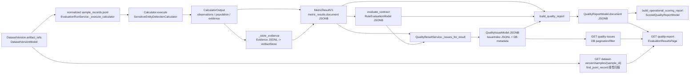

# qa-eval 评测结果模块现状审计与问题根因分析（Phase 1）

> 审计日期：2026-11-10  
> 重点案例：`0202@2.0.0` / `bg_06_01_sensitive_entity_detection@1.0.0`  
> Dataset Version：`01a1a9a4-c688-7a18-a70b-927c73ab24e0`  
> Run：`01a1c334-10e8-7d92-91bc-5bc01d7c4123`  
> 范围：仅审计与根因分析；未修改业务代码、数据库、配置或运行数据。

## 1. 执行摘要

当前系统已打通 Dataset Version、执行计划、Calculator、MetricResult、RuleEvaluation、QualityIssue、QualityReport / ScoredReport 与前端展示，且 Calculator 已产出可审查的记录/字段/span 级敏感实体证据文件。主要问题不是“没有证据”，而是证据 Artifact 未被 0202 的 Issue 生成器解析：通用阈值失败逻辑只取第一个 Evidence ID，生成 Dataset-level Issue 和 measurement locator，导致记录级命中在 Calculator 与 MetricResult 之间保留，却在 QualityIssue 及 UI 不可见。

`max_records=20` 是 Calculator Registry 参数默认值和 Calculator 内部兜底，实际采用“前 20 条”，不是 Planner/Reader 的统一抽样。`scan_coverage_ratio=1.0` 计算的是已选中文本的字符扫描完整度，不是数据集记录覆盖率；MetricResult 却仍标记 `OK`，使规则可对 20/321,902 的部分扫描直接 FAIL。正式评分为空主要是 0202 v2 measurement 为中性计数、无指南评分映射；运营评分为空则是 Profile 仍期待 v1 的 `safe_record_ratio`，并且采样估计策略要求 `PARTIAL` 而实际结果是 `OK`。第二阶段应优先统一扫描/覆盖语义、建立通用 Finding→Issue 物化边界，并对记录原文建立可索引定位。

## 2. 当前完整数据链路

已验证的调用顺序为：`EvaluationRunService._execute_calculator()` 构造 `CalculatorContext` 并执行 Calculator，`_store_evidence()` 将 Calculator 产出的 JSONL 存入 Artifact Store，再将 Evidence 元数据嵌入 `MetricResultV1` 并持久化；`QualityResultService.finalize()` 从 DB 重读 MetricResult，生成 RuleEvaluation、QualityIssue/IssueIndex 和 QualityReport；运营评分是从已持久化事实构建的独立不可变快照，不会重跑 Calculator。

## 3. 关键模块与文件索引

| 模块 | 文件路径 | 核心类/函数 | 当前职责 | 主要问题 |
| --- | --- | --- | --- | --- |
| 0202 Calculator | `src/qa_eval/calculators/sensitive_entity_detection/calculator.py:118` | `SensitiveEntityDetectionCalculator` | 规则+UIE 检测、聚合测量、输出命中 JSONL | 前 N 条限制内嵌；部分扫描仍返回 OK |
| Calculator 协议 | `src/qa_eval/calculators/protocol.py:29` | `CalculatorContext/Output/EvidenceOutput` | 统一输入、结果和 Evidence Artifact 声明 | 没有统一 Finding 流或进度/检查点协议 |
| Registry | `configs/registry/calculators/bg-06-01-sensitive-entity-detection-v1.0.0.json` | descriptor | 参数默认值、能力、资源和可用性 | 默认 20 是 Calculator 局部策略 |
| Binding | `configs/registry/bindings/0202-v2-sensitive-entity-detection.json` | binding | 0202 v2 与 Calculator/五个 measurement 绑定 | 与运营评分 Profile 版本不一致 |
| Metric 定义 | `configs/registry/metrics/0202-v2.0.0.json` | `MetricDefinitionV1` 数据 | 声明五个测量及局限 | 主测量方向 NEUTRAL，未定义正式评分映射 |
| Executor | `src/qa_eval/application/services/evaluation_run_service.py:825,980` | `_execute_calculator`, `_store_evidence` | 读 normalized Artifact、执行、存 Evidence/MetricResult | 整个 stage 重跑；无记录级检查点 |
| MetricResult | `src/qa_eval/contracts/metrics.py:93` | `MetricResultV1` | 保留 observations/population/coverage/Evidence 元数据 | Evidence 只是 Artifact 级引用，无内建行级查询 |
| Rule evaluator | `src/qa_eval/application/evaluation/rule_evaluator.py:67` | `evaluate_contract_item` | 精确版本+measurement 阈值判定 | `OK` 部分扫描会被当成可直接判定 |
| Issue 物化 | `src/qa_eval/application/services/quality_result_service.py:194` | `_issues_for_result`, `_rule_failure_issues` | 通用阈值 Issue；0208 专用记录 Issue | 没有 0202 detector；通用 Issue 丢失命中定位 |
| Issue Index | `quality_result_service.py:381` | `_persist_issue_index` | 把 Issue 复制为 JSONL Artifact 并记录过滤能力 | API 实际查 DB，未查 Index Artifact；存在双写 |
| Report | `src/qa_eval/application/evaluation/report_generator.py:78` | `build_quality_report` | 聚合指标、Issue 摘要、覆盖和正式评分 | 仅保留 Evidence ID，不内联证据行 |
| Scoring | `src/qa_eval/application/evaluation/operational_scoring.py:56` | `_contribution` | Profile 测量映射与采样估计 | 0202 Profile 仍为 v1 measurement |
| JSONL 查询 | `src/qa_eval/application/artifact_jsonl.py:14` | `read_jsonl_page`, `find_jsonl_record` | 有界内存页读/单条扫描 | 每次物化整个 Artifact，offset/id 查询线性 |
| 后端 API | `apps/api/routes/quality_results.py` | report/rules/issues handlers | 报告、分页 Issue、按 result 过滤 | 无 Evidence ID 详情/行分页 API |
| 原文 API | `apps/api/routes/dataset_versions.py:235,269` | samples/sample by id | 预览、按 sample_id 查询 | 无索引，不是 raw snapshot 原始行 |
| 前端 | `apps/web/src/pages/EvaluationResultsPage.tsx:77` | `EvaluationResultsPage` | 总览、覆盖、指标、Issue 过滤/分页、样本弹窗 | 只展示 Evidence ID；Dataset Issue 无原文入口 |

## 4. 问题根因分析

### A. 0202 数据读取与扫描策略

**当前实现与代码证据**

- `已验证` `max_records=20` 同时存在于 Registry descriptor 的默认值（第 19 行）与 Calculator `validate/execute` 的兜底（`calculator.py:155-174`）。Executor 仅将 plan stage parameters 透传，限制不来自 Reader、Contract 或 Executor。
- `已验证` 输入是 `sample_records.jsonl`，Calculator 逐行读取，内存有界；但它会继续遍历剩余 321,882 行以累计 `input_count`，只是不解析与检测。
- `已验证` 抽样为文件顺序的前 N 条：`input_count > max_records` 时直接记录 `SAMPLED_OUT_MAX_RECORDS`（`calculator.py:197-203`）。无随机、分层、种子、样本权重或统一 SamplingStrategy 接口。
- `已验证` 把 `max_records` 设为大于等于记录数可实现全量扫描，但无显式 `None/unlimited` 语义，且 descriptor 资源限制为 768 MB / 600 s，UIE 对每个文本 window 同步调用，大数据集实际不可扩展。
- `已验证` UIE 与确定性规则用同一批记录/字段；规则一次扫文本，UIE 按 320 字符、64 字符重叠切窗，每窗同步 `provider.infer()`（`calculator.py:244-259`）。
- `已验证` `scan_coverage_ratio = scanned / eligible`（`calculator.py:358-391`）；两者都是已入样记录中被选文本的字符数。因每个选中文本最终都累加 `scanned += len(text)`，正常完成必然为 1.0，与 20/321,902 无关。
- `已验证` `MetricPopulation` 只有 input/evaluated/excluded 及 reason counts；Calculator 内部有 selected/eligible/scanned，但 selected 是字段数、eligible/scanned 是字符数，没有独立的适用记录、成功扫描记录、失败记录结构。
- `已验证` StageRun 有 `attempt` 和状态，但当前创建 attempt=1；0202 没有 checkpoint、断点、记录级重试或可持久化进度。UIE 超时会使整个 Calculator/Stage 失败，不会仅排除单条。

**根因、影响与复用**

根因是扫描范围被当作 Calculator 私有参数，而不是 Planner/Executor 可记录、可复现的统一执行策略；同时“文本内扫描完整度”与“数据集覆盖率”同名混用。可复用 JSONL 流式遍历、Population exclusion 和 SemanticCoverage；缺失统一采样元数据、进度、checkpoint 和批处理调度。影响评分置信度、复现性和大规模运行稳定性。

### B. Calculator 输出与 MetricResult

- `已验证` 输入 Schema 为 SampleRecord 2.0，输入 Artifact 必须是 `NORMALIZED_DATA`；适用 role 为 `article.body.html` / `article.body.plain` / `article.title`。优先选 HTML body，否则 plain body，再加 title（`calculator.py:205-225`）。
- `已验证` 协议输出为 `CalculatorOutput`：observations、population、semantic_coverage、status/status_detail、evidence Artifact 描述和 diagnostics。Calculator 返回五个 observations：`sensitive_entity_hit_count`、`type_counts`、`affected_record_count`、`evaluated_record_count`、`scan_coverage_ratio`；另返回三类 diagnostics（扫描计数/模型信息/部分范围）。
- `已验证` 命中 JSONL 每行包含 `sample_id`、`content_id`、`logical_field`、`category`、`start/end`、coordinate space、mapping precision、channels、脱敏 excerpt、model id/score/original label、rule ids、review status（`calculator.py:286-312`）。没有未脱敏 `matched_text`；`sample_id` 可作 record ID，confidence 对 NER 为 `model_score`。
- `已验证` Calculator 直接写 Evidence 文件并返回 `EvidenceOutput`，不直接构造最终 `EvidenceArtifact`/QualityIssue。Executor 上传文件、计算 checksum，将 ArtifactRef、summary 和 redaction 嵌入 MetricResult（`evaluation_run_service.py:1020-1059`）。
- `已验证` `evidence_limit=100` 只截断写出的证据行，不截断命中统计；summary.attributes 显式保留 total/written/capped。
- `已验证` CalculatorOutput 支持多 observation 和多 EvidenceOutput；Binding 列出的五个 measurement 与 0202 v2 Metric Definition 及实际输出一致。
- `已验证` 丢失并非发生在 Calculator→MetricResult：命中文件被完整保存为 Artifact，MetricResult 保留其 ID/URI/checksum/schema/summary。丢失发生在 MetricResult Evidence→QualityIssue 物化。
- `已验证` 部分扫描表达冲突：semantic coverage 始终 `PARTIAL`、status_detail.partial_scope 为 true，但 result status 仍为 `OK`。`MetricResultV1` 仅强制 `PARTIAL status => PARTIAL semantic coverage`，不禁止 `OK + PARTIAL coverage`。

可直接复用 Calculator 协议、多 measurement、Evidence Artifact 元数据、checksum/redaction/summary 和 Population/SemanticCoverage。需扩展 status/coverage 一致性与可流式消费的 Finding 边界。

### C. Evidence、Finding 与原文追溯

- `已验证` 没有通用、独立持久化的 Finding 表/契约。Calculator 可自定义 Evidence JSONL schema；0208 的 duplicate groups 是相似概念，但由 `QualityResultService` 特判 metric key 并解析。
- `已验证` Evidence 实体是 Artifact Store 文件 + MetricResult JSONB 中的 `EvidenceArtifact` 元数据，没有独立 Evidence DB 表。Schema 包含 evidence_id/kind/schema_ref/artifact/subject_scope/summary/redaction（`contracts/metrics.py:72-90`）。
- `已验证` Issue locator 的 Schema 只是任意 JSON object（`contracts/quality.py:246-248`）；因此技术上能表达 measurement、group_id、span 等，但没有 discriminator、版本和统一语义。
- `已验证` 0202 最终只剩 measurement locator 是因 `_rule_failure_issues()` 只选 `result.evidence[0]`，不读 Artifact，并硬编码 `locator={"measurement": ...}`（`quality_result_service.py:298-327`）。
- `已验证` QualityIssue 可关联多个 Evidence ref，也支持 DATASET/GROUP/SAMPLE/PAIR/CONTENT/ANNOTATION subject 与 related subjects。但 0202 未注册专用 detector，故所有命中仅聚合成一个 Dataset threshold Issue。
- `已验证` 系统无 `GET evidence/{id}` API，也无 Evidence 行分页/过滤/索引 API。Evidence ID 只能通过 MetricResult document 找到 Artifact URI，前端只显示 ID。
- `已验证` 支持通过 sample_id 返回标准化 SampleRecord，不支持通过 Evidence locator 自动解析原文。字段/span 信息已在 0202 evidence 中；HTML 的 span 是可见文本 code-point 坐标，不是 raw HTML offset/DOM path。
- `已验证` SampleRecordV2 保留 source_artifact_id/source_record_id/source_row/locator 和 transform lineage。对 jhsjk，`sample_id == source_record_id`，可定位来源记录；但 `html_to_complete_plain_text` 只记 transform/version，不保留字符对齐表，所以 plain span 不能稳定反射到 raw `content` 的 HTML offset。
- `已验证` Calculator 不写原始敏感值，只写 mask，Evidence 声明 `contains_raw_content=false`。这是已有脱敏能力。`待验证` 未在当前链路找到 Artifact 级授权、敏感原文访问审计或行级权限；仅能确认 API 路由本身没有这些检查。

分类结论：Evidence Artifact、多 Evidence 关联、多类 subject、脱敏和 SampleRecord lineage **已实现可复用**；0202 命中解析、Evidence 详情 API 和 span 展示 **已有数据但未接入**；通用 Finding contract、Evidence 索引和 raw/normalized 字符映射 **缺失**。

### D. 数据集存储与原文查询

- `已验证` 规范化时将 raw snapshot、`sample_records.jsonl`、rejected JSONL 和 manifest 写入 Artifact Store（`jhsjk_article_normalizer.py:329-349,547+`）；`dataset_versions.artifact_refs` JSONB 保留引用。
- `已验证` 无逐条 SampleRecord DB 表、无 sample_id/record_id 索引、无 JSONL 字节偏移索引。
- `已验证` 预览使用 `read_jsonl_page()`，每次先将 Artifact 物化到临时文件，再从头跳过 offset；访问第 k 页是 O(k)。按 ID 使用 `find_jsonl_record()` 从头 JSON parse 直到命中，最坏 O(N)。
- `已验证` jhsjk normalizer 直接以映射的业务 ID 作 `sample_id` 和 source_record_id，并保留 source_row。在同一 Dataset Version 中稳定；新版本是新 Artifact，只有上游 ID 稳定时才能跨版本对齐。Evidence 另带 dataset_version_id，不应默认跨版本。
- `已验证` 当前原文弹窗返回的是 normalized SampleRecord 内容，并非从 raw snapshot 按 source_row/record_id 取回的原始行。
- `待验证` Local/S3 ArtifactStore 底层可能利用系统/对象存储缓存，但应用层没有 record cache；`_materialized_artifact` 每次仍请求 materialize 并删除临时文件。

因此，**如果 Evidence 只保存 record_id，当前系统不能在不全文件线性扫描的情况下快速取回原文**。这是原文链路的最大性能约束，321,902 条下的多 Issue 交互会重复下载/扫描大 JSONL。

### E. RuleEvaluation 与 QualityIssue 生成

- `已验证` `evaluate_contract()` 以 `(metric key, version, measurement)` 选择 MetricResult，阈值规则包含 LT/LTE/GT/GTE/EQ/NE 或 OBSERVE_ONLY。对 `OK` 观测直接比较；`PARTIAL` 不比较，返回 `PARTIAL_RESULT`。
- `已验证` `THRESHOLD_VIOLATED` 在 `rule_evaluator.py:162-195` 由 operator 返回 false 时生成；Issue 的同名 code 在 `_rule_failure_issues()` 中二次物化。
- `已验证` 通用阈值 Issue 硬编码为 Dataset subject、`CONFIRMED`、通用 message 和 measurement locator；severity 来自 contract item，dedup 键含 metric+reason+rule evaluation ID。没有 0202 专属解释模板或结构化问题详情。
- `已验证` Schema 支持 Record/Sample-level Issue、related subjects、CANDIDATE/CONFIRMED；0208 专用分支已示范如何从 Evidence 生成多个 SAMPLE Issue 及 candidate。0202 没有对应分支。
- `已验证` 当前的确实存在“阈值失败被标为确认违规”：`_rule_failure_issues()` 无条件设 `determination=CONFIRMED`。严格地说，不是 Calculator 直接把命中判违规，而是发布 Contract 对 hit count 设定阈值后，通用 Issue 物化将 Rule FAIL 等同为 confirmed violation。它不检查 `review_status=UNREVIEWED`。
- `已验证` Issue 有 OPEN/ACKNOWLEDGED/RESOLVED/DISMISSED Schema 和 dedup key，但当前服务只创建 OPEN，未找到状态更新/人工复核 API。去重受 DB `(run_id,dedup_key)` 唯一约束保护，无跨 run 合并。
- `已验证` 报告推荐与 Issue 生成分离；`evaluation_recommendation_service.py` 和 report generator 有通用/启发式推荐能力，Issue 本身没有 recommendation 字段。

根因是系统只有“通用规则失败 Issue”与个别 metric 硬编码 detector，缺少通用 Finding→Issue 插件边界，并将“规则确定失败”和“业务事实已人工确认”共用 `CONFIRMED` 语义。

### F. Quality Report 与 Scored Report

- `已验证` QualityReport 从已提交的 MetricResult/RuleEvaluation/Issue/IssueIndex 构建；每个 result 保留一个 section，主 measurement 由 contract item 确定，其余 observations 列为 diagnostics（`report_generator.py:181-257`）。
- `已验` Report 仅保留 `evidence_ids`，不嵌入记录级证据；Issue 详情通过独立分页 API 从 DB 加载，这避免了 Report JSON 膨胀。
- `已验证` Issue summary 由 QualityIssue 按 determination/code/scope 计数，并与 IssueIndex summary 交叉验证。
- `已验证` Report population 直接复制 MetricResult population；`coverage_analysis.data_by_metric` 使用 evaluated/input 的记录口径，与 0202 observation `scan_coverage_ratio` 的字符口径不统一。
- `已验证` guide coverage 以 `(metric_key, metric_version)` 去重；Registry 同时存在 0202 v1/v2，catalog 会把未被 contract 选中的版本作 `NOT_EVALUATED` 展示，因此报告可同时出现 v1 和 v2，这是“Registry 实现目录”与“本次 Contract 执行集”混合展示的产物，不是同一 metric 被执行两次。
- `已验证` “实现 16/16”分母是适用的 Registry metric catalog，分子是有可用 Binding/Calculator 的 metric；“执行 1/16”为其中有 MetricResult 的 metric；“观察 1/16”为有 OK/PARTIAL observation 的 metric；“有效评分 0/0”表示适用目录中没有具备指南权重+映射的 metric，分母为 0 时 ratio 为 null。`待验证` 16 的实际 catalog 行需连接本次 DB 快照确认；代码口径已验证。
- `已验证` 报告能区分 execution status、Rule PASS/FAIL、scoring eligibility/score。正式评分不是规则判定；Rule FAIL 不自动等于有正式分。
- `已验证` 正式 Score 为 null 符合当前设计：0202 v2 测量 direction 是 NEUTRAL，缺少明确权重/分数映射；不应仅因为空值判定为 Bug。
- `已验证` 运营 Profile `data-quality-mvp-score-v1.json` 对 metric_id 0202 固定期待 `safe_record_ratio`，这是 0202 v1 语义；operational scorer 只按 metric key 选 result，不校验 metric version（`operational_scoring.py:144-152`），随后找不到 measurement，产生 `MEASUREMENT_MISSING`。此外 Profile 的 `SAMPLED_ESTIMATE` 要求 result.status == PARTIAL，当前 OK 还会产生 `SAMPLED_ESTIMATE_REQUIRES_PARTIAL_RESULT_OK`。这是真实的版本/语义缺陷。

### G. 前端评测结果模块

- `已验证` 总览、雷达图、覆盖率、维度评分、指标卡片、Issue 列表和样本弹窗集中在 `EvaluationResultsPage.tsx`；未拆成独立业务组件。
- `已验证` 前端调用 run list/detail、quality report、operational scoring、quality issues 和 dataset sample-by-id API。报告字段直接来自后端；前端只做显示格式、雷达图坐标和样式判断，不重算评分/覆盖。
- `已验证` 中文 status/enum 多由 `utils/displayLabels.ts` 映射，但报告中 `basis`、reason/exclusion 等英文是后端直传，无完整统一的后端 message code + 前端 i18n 层。
- `已验证` Issue API/FE 支持 limit/offset 分页、determination 和单个 metric_result_id 过滤；页面已提供“全部/按指标结果”按钮。尚无 code/severity/scope/sample_id 搜索 UI，API 也未暴露这些已在 IssueIndex schema 声明的过滤条件。
- `已验证` SAMPLE Issue 已有“查看样本原文”按钮；DATASET Issue（当前 0202）没有 sample_id，因此无按钮。弹窗展示 normalized contents，没有 Evidence span 高亮。
- `已验证` “评测溯源与证据”只显示 MetricResult/StageRun/Evidence IDs，没有证据详情组件。
- `已验证` 前端已区分 MetricResult status、Rule status、正式 score 和 MVP 运营 estimate，并明确提示后者非指南正式分。

前端可直接复用页面框架、分页、指标过滤、样本 Modal 和状态标签。核心信息损失主要来自 API 没有返回 0202 记录级 Issue/Evidence 详情，不是前端将已有字段丢弃。

### H. 通用性与架构边界

| 证据形态 | 现有支持 | 审计结论 |
| --- | --- | --- |
| 单记录单/多证据 | Issue `evidence[]` + SAMPLE/CONTENT subject | Schema 支持；缺通用物化器 |
| 跨记录/多记录组 | GROUP/PAIR/related_subjects，0208 已使用 | 可复用，但实现与 metric key 硬绑定 |
| 字段级 | CONTENT subject + 自由 locator | 可表达，未规范 locator |
| 文本 span | 0202 evidence 有 start/end/coordinate space | Calculator 已有，Issue/API/UI 未接入 |
| Dataset 统计 | DATASET subject + observations | 已完整支持 |
| 多 Calculator 统一输出 | CalculatorOutput/EvidenceOutput | Artifact 层统一，Finding 行 schema 不统一 |
| 单指标/综合评测 | 同一 Run/Result/Report 链路 | 已支持；报告可包含多 Calculator section |

通用层应保持 CalculatorOutput、Evidence Artifact、Issue subject/ref、Report 摘要和分页加载；指标专属层负责检测语义、Finding schema、定位坐标与默认解释。当前架构冲突是这个边界实际放在 `QualityResultService` 的 `if metric_key == ...` 中，会随 0204/0206/0208 扩展而膨胀。

## 5. 当前 Schema 与数据模型

| 对象 | 核心字段/关联 | 持久化 | 现状 |
| --- | --- | --- | --- |
| CalculatorOutput | observations, population, semantic_coverage, status, status_detail, evidence[], diagnostics[] | 进程内 DTO；Evidence 先写临时文件 | 可表达多 measurement/多 Artifact，不表达通用 Finding |
| MetricResultV1 | IDs, versioned metric, DATASET subject, status, observations, population, semantic coverage, evidence[] | `metric_results` 索引列 + `document JSONB` | Evidence 仅保存 Artifact 元数据，行在 Artifact |
| EvidenceArtifact | evidence_id, kind, schema_ref, ArtifactRef, subject_scope, summary, redaction | 嵌入 MetricResult JSONB；内容在 Artifact Store | 无独立 DB/API；无通用 locator schema |
| RuleEvaluationV1 | contract/item/result IDs, metric selector, subject, status, observed, rule, reason | `rule_evaluations.document JSONB` | 引用 MetricResult，不引用 Evidence |
| QualityIssueV1 | source/detector/category/code/determination/severity/scope/subject/related/evidence[]/status | `quality_issues.document JSONB` + 查询索引列 | 可多 Evidence/多 scope；0202 仅 Dataset Issue |
| IssueIndexV1 | issue_index_id, ArtifactRef, supported_filters, summary | `issue_indices.document JSONB` + JSONL Artifact | 是 Issue 快照；API 实际查 QualityIssue DB |
| QualityReportV1.1 | execution/gate/coverage/dimensions/metric sections/issue summary/scoring/radar/guide coverage | `quality_reports.document JSONB` | 保留 Evidence IDs 和 Issue summary，不嵌入 Issue/Evidence 行 |
| OperationalScoringReportV1 | base report/profile IDs, contributions, official/estimated radar, exclusions | `scored_quality_reports.document JSONB` | 独立快照，不改写基础报告 |

实际关联：`MetricResult 1→N EvidenceArtifact(metadata)`；`MetricResult 1→N RuleEvaluation`；`MetricResult 1→N QualityIssue`；`QualityIssue N↔N Evidence` 是应用层 ID ref，无 DB FK；`MetricResult 1→1 IssueIndex`；`Run 1→1 QualityReport`；`QualityReport 1→N ScoredReport(profile/version)`。

## 6. 前后端 API 映射

| 前端功能 | 前端组件 | API | 后端 Handler/服务 | 数据来源 | 当前限制 |
| --- | --- | --- | --- | --- | --- |
| Run 列表/状态 | `EvaluationResultsPage` | `GET /api/v1/evaluation-runs` | `evaluation_runs.py` / `EvaluationRunService` | evaluation_runs | 页面组件较大 |
| 报告总览/指标/覆盖 | 同上 | `GET .../{run}/quality-report` | `quality_results.get_report` | quality_reports.document | 仅 Evidence ID |
| 延迟最终化 | 同上 | `POST .../{run}/finalize` | `finalize_run` | MetricResult + contract | 已有报告则返回旧快照，不重建 |
| MVP 运营评分 | 同上 | `GET/POST .../operational-scoring[/rebuild]` | `get/rebuild_operational_report` | scored report / persisted facts | Profile 不匹配 0202 v2 |
| QualityIssue 列表 | 同上 | `GET .../{run}/quality-issues` | `list_issues` | quality_issues DB | 只暴露 determination/result 过滤 |
| 按指标切换 Issue | 指标按钮 | 同上 + `metric_result_id` | `QualityResultService.list_issues` | indexed metric_result_id | 按 result 而非 calculator key；对现模型等价 |
| 样本预览 | Dataset version 页 | `GET .../dataset-versions/{id}/samples` | `dataset_versions.list_samples` | normalized JSONL | offset 线性扫描 |
| 查看样本原文 | Issue 列表 Modal | `GET .../dataset-versions/{id}/samples/{sample_id}` | `get_sample_by_id` | normalized JSONL | O(N)；非 raw；无 span 高亮 |
| Rule 详情 | 暂无独立 UI | `GET .../{run}/rule-evaluations` | `list_rules` | rule_evaluations DB | 页面只用 report 中的简化 ref |
| Evidence 详情 | 暂无 | 无 | 无 | MetricResult + Artifact Store | 核心缺口 |

## 7. 0202 真实执行链路复盘

> 指定 Run 的 DB 记录、Contract document 和 Evidence Artifact 未作为仓库文件出现，当前环境未执行数据库/对象存储读取。以下对“321,902/20/1”的数值采用任务提供的已观测运行结果，对生成机制均已用代码验证。

1. **为什么只扫描 20 条**：`已验证` plan 如未覆盖参数，Registry 默认和 Calculator 兜底都取 20。Calculator 按 JSONL 顺序只对前 20 条执行检测，其余记为 `SAMPLED_OUT_MAX_RECORDS`。`待验证` 需从指定 Run 的 PhysicalPlan/StageRun document 确认它当时未显式传入其他值；运行数字与默认值一致。
2. **为什么命中 1 个实体**：`推断` 前 20 条的规则+UIE 合并去重结果中有一个 `MOBILE_PHONE_CN`；命中坐标、channel 和 mask 应在 `sensitive-entity-hits.jsonl`。未读取该 Artifact，故命中原因与样本 ID `待验证`。
3. **为什么 MetricResult 为 OK 且 coverage=1.0**：`已验证` Calculator 只在无输入/无适用文本时返回 MISSING/NOT_APPLICABLE，正常路径默认 OK；coverage 是入样文本字符 scanned/eligible，不是 20/321,902。
4. **为什么 Rule FAIL**：`已验证` Contract 选中 `sensitive_entity_hit_count` 后，RuleEvaluator 用观测值 1 与阈值比较。`待验证` 具体 operator/threshold 需读指定 contract；但 FAIL 必然由该比较返回 false，不由 Calculator 产生。
5. **为什么生成 Dataset-level Issue**：`已验证` 0202 无专用 Issue detector；通用 `_rule_failure_issues()` 对每个 FAIL 硬编码 Dataset scope/subject、CONFIRMED 和通用 message。
6. **为什么 Evidence 无法定位原文**：`已验证` 记录/span 数据仍在 Evidence Artifact，但 Issue 生成时未读它，locator 被重新构造为 measurement-only；前端因 Issue subject 是 DATASET 也无 sample 按钮。
7. **为什么正式评分为 null**：`已验证` RuleEvaluation 与正式 guide scoring 是独立链路。0202 v2 measurements 是 NEUTRAL 且无显式指南权重/映射，不具备可评分条件。
8. **为什么运营估计为 null**：`已验证` Profile 期待 `safe_record_ratio`，0202 v2 结果没有；同时策略要求 PARTIAL 而结果为 OK。两个 exclusion reason 任一都会使 contribution score 置 null。

## 8. 已有能力复用清单

### 可直接复用

- SampleRecordV2 的 sample/content/source/lineage 标识。
- CalculatorContext/Output 和多 measurement 输出。
- Evidence Artifact 上传、checksum、schema ref、summary、redaction metadata。
- MetricResult population/semantic coverage/status 框架。
- QualityIssue 的多 scope、related subjects、多 Evidence ref、dedup/status 契约。
- QualityReport 摘要 + Issue 独立分页加载的分层方式。
- 前端按 metric result 过滤、分页和样本 Modal。

### 需要扩展

- 将采样与扫描范围从 Calculator 私有参数提升为计划/执行元数据。
- 约束 status、population、semantic coverage 与 scoring eligibility 的一致性。
- 将 metric-specific Evidence 解析从 `QualityResultService` 硬编码分支抽离为可注册能力。
- 扩展 Issue API 的 code/severity/scope/sample_id 过滤。
- 扩展前端 Evidence 详情、span 高亮、candidate/review 展示。
- 使 Scoring Profile 明确绑定 metric version/measurement 版本。

### 需要新增

- 通用的记录/组/span Finding contract 或等价的标准 Evidence row envelope。
- Evidence ID 详情、行分页和授权审计 API。
- sample_id→JSONL byte offset/分片索引或记录查询存储。
- raw HTML↔normalized/plain text 的坐标映射（如业务要求精确回溯）。
- 记录级进度、批次、checkpoint/重试。

### 存在架构冲突

- Issue 一方面在 DB 逐条存储，一方面复制为 IssueIndex JSONL，但查询只走 DB；权威源与大规模存储边界不清。
- Evidence 设计为 Artifact 级，但交互要求行级查询，当前缺索引层。
- `CONFIRMED` 同时表示“确定性规则失败”与“已确认业务违规”，与 0202 的 UNREVIEWED finding 冲突。

## 9. 问题优先级与依赖关系

### P0

1. **扫描范围与结果状态语义不一致**：20/321,902 仍 OK，Rule 可直接 FAIL。这会影响结论正确性，应先于评分与 UI 修复。
2. **0202 Finding 未物化为记录级 Issue**：导致证据链在业务展示层断裂。依赖 Finding/locator 边界决策。
3. **命中候选被通用阈值 Issue 标为 CONFIRMED**：存在语义/合规风险，需与人工复核模型一起确定。
4. **原文按 ID O(N)**：记录级 Issue 上线前必须有可接受的索引/分片方案，否则会放大为稳定性问题。

### P1

1. 0202 v2 与运营 Scoring Profile 的 measurement/version 不匹配。依赖 0202 v2 是否可评分、如何评分的业务决策。
2. Evidence 详情/分页 API 和前端 span 展示。依赖 locator/Finding schema、权限与脱敏决策。
3. 统一采样策略、sampling metadata 和可复现性。依赖 Planner/Executor 责任边界。
4. 大规模执行的批处理、进度、checkpoint/重试。

### P2

1. 拆分前端大页面、完善中文枚举/原因码映射。
2. 暴露更多 Issue 筛选/搜索能力。
3. 明确 Issue DB 与 IssueIndex Artifact 的权威源、保留周期和双写一致性。
4. 统一 guide coverage 的“已注册版本”与“当前指南项”展示口径。

## 10. 第二阶段设计决策清单

| 决策问题 | 当前可选方向 | 现有架构约束 | 需进一步验证 | 影响模块 |
| --- | --- | --- | --- | --- |
| 采样归属哪一层 | Planner 生成；Executor 统一执行；Calculator 声明需求 | 现为 Calculator 私有 | 其他 Calculator 的抽样方式 | planner/executor/calculator |
| 部分扫描应是 OK 还是 PARTIAL | 以记录范围；以语义覆盖；分拆两轴 | RuleEvaluator 对 PARTIAL 不判阈值 | Contract 对采样结果的政策 | contracts/rules/scoring/report |
| Finding 是独立对象还是 Evidence row envelope | DB 实体；Artifact JSONL；混合索引 | Evidence 现为 Artifact，Issue 为 DB | 0204/0206/0208 数量与查询模式 | calculator/result/issue/API |
| 谁将 Finding 物化为 Issue | Calculator；可注册 detector；通用 declarative mapping | 现有 0208 硬编码分支 | 不同 metric 的判定/复核语义 | quality result service/registry |
| Locator 如何版本化 | discriminated union；按 Evidence schema 自定义 | 现是任意 JSON | 字段/span/group/pair 最小公共集 | contracts/API/frontend |
| 原文查询如何加速 | byte-offset index；分片文件；记录表/查询存储 | ArtifactStore 是当前权威源 | S3/local 部署、文件尺寸、QPS | normalization/storage/API |
| 展示 raw 还是 normalized 内容 | 只展示 normalized；可选 raw；并列对齐 | raw 可含敏感值，无坐标映射 | 权限/脱敏/合规要求 | normalization/evidence/UI |
| 0202 命中的 determination | 默认 CANDIDATE；规则类型分级；人工复核后 CONFIRMED | 当前 Rule FAIL 直接 CONFIRMED | 业务上“违规”标准 | contract/issue/review/UI |
| 0202 v2 是否进入评分 | observe-only；新 ratio；明确的 count mapping | 现有 measurements 均 NEUTRAL | 指南依据、权重和置信度 | metric/scoring/profile/report |
| Issue DB 与 Index Artifact 谁是权威源 | DB authoritative；Artifact authoritative；冷热分层 | 当前双写且 API 只查 DB | 规模、保留、更新/复核要求 | persistence/API/deletion |
| 如何断点续跑 | stage 级；batch 级；record 级 | StageRun 有 attempt 但 Calculator 无 checkpoint | UIE 吞吐/失败率、Artifact 合并 | executor/calculator/artifacts |

## 11. 审计结论

当前问题是多因素，但责任并不平均：

1. **证据模型与问题生成是主要根因**。Calculator 已经产生 sample/content/span 命中，但系统没有通用 Finding 物化边界；0202 未接入 metric-specific detector，通用 threshold Issue 只保留 measurement locator。
2. **执行编排是结论可信度的核心根因**。采样内嵌于 Calculator，没有统一 sampling metadata，部分扫描仍 OK，使 RuleEvaluator 无法正确区分全量事实与样本观测。
3. **Calculator 有局部责任，但不是证据丢失的主因**。它的 `max_records` 默认、coverage 命名和 OK/PARTIAL 状态不合理；但命中 Evidence 内容本身比最终 Issue 丰富。
4. **报告聚合总体尽责**：它保留 ID、摘要、population 和状态，且避免将大量 Issue/Evidence 嵌入报告。问题在于上游口径不统一以及 guide catalog 与执行集展示混杂。
5. **评分配置有明确版本缺陷**：运营 Profile 仍绑定 0202 v1 的 `safe_record_ratio`，且 scorer 只按 metric key 取 result。正式评分空值则是当前缺少指南映射时的刻意保守设计，不应与运营配置缺陷混为一谈。
6. **前端不是主要丢失点**。它已能按指标过滤、分页和查看 SAMPLE 的 normalized 原文；0202 无法下钻是因后端只生成 DATASET Issue 且没有 Evidence 详情 API。

综合责任边界：**正确性问题优先归因于执行编排与状态语义；可追溯性问题优先归因于 Evidence/Finding 模型和 Issue 生成；评分空值需分别归因于正式映射未定义与运营 Profile 版本不匹配；前端主要是上游数据缺口的放大器。**

## 附录：验证边界

- `已验证`：本报告所引源码、Schema、Registry/Scoring 配置、迁移、测试与前端调用关系。
- `推断`：指定 Run 的唯一命中来自前 20 条中的手机号检测；此与运行摘要一致，但未读 Evidence Artifact 行。
- `待验证`：指定 Run 的 PhysicalPlan 实际 parameters、Contract operator/threshold、命中 sample_id/span、DB 中 16 个 catalog 项的快照，以及部署环境的认证/授权中间件。

