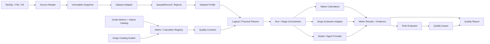

# qa-eval 借鉴 Dingo 的架构与 `jhsjk_article` 评测实施方案

> 文档日期：2026-10-23
> 状态：设计建议，尚未进入编码
> qa-eval 基线：`plan/v0/pm-v0.md`、`plan/v0/rd-v0.md` 及当前仓库实现
> Dingo 基线：本地 `external/dingo`，`dingo-python 2.5.0`，commit `816aaae942746233851844a3f28ecb078c68a06b`，Apache-2.0

## 1. 结论

qa-eval 与 Dingo 的功能表面相似，但产品边界不同：

- Dingo 更像“可直接运行的数据/模型质量评测工具箱”：强调多数据源、规则/LLM/Agent 评估器、Local/Spark 执行、CLI/SDK/MCP，以及快速输出好坏样本和汇总报告。
- qa-eval 的目标是“高质量数据集平台中的质量评测基础服务”：强调不可变 Dataset Version、指南指标语义、Metric Definition 与 Calculator 分离、Quality Contract、逻辑/物理计划、四态判定、证据追溯、质量门禁、人工反馈和版本复评。

因此建议采用“借能力与设计，不替换核心领域模型”的路线：

1. 保留 `pm-v0.md` / `rd-v0.md` 的总体架构作为目标架构，不以 Dingo 重写 qa-eval。
2. 优先借鉴 Dingo 的多字段评测配置、评估器注册机制、规则/LLM/Agent 分层、SQL 流式读取、执行后端抽象、指标目录、CLI/MCP 接口和报告下钻体验。
3. 不直接采用 Dingo 的 `Data → EvalDetail → good/bad → score` 作为 qa-eval 的核心协议；必须适配为 `Metric Result → Rule Evaluation → Quality Issue → Quality Report`。
4. 第一阶段不要把 Dingo 作为运行时强依赖。源码证明其注册器、配置和 evaluator 均使用全局可变类状态，并通过递归 import 发现插件；并发多租户平台不能直接复用这一运行模型。
5. 用 `policy.jhsjk_article` 作为垂直切片：先完成真实快照、标准化、画像、首批确定性指标、契约判定、问题与报告，再引入 Dingo 的规则和 LLM 能力。
6. Dingo 2.5.0 已包含 TC609/国标命名的 0101—0104 LLM evaluator 和 0201—0208 rule，但不能按名字视为指南完整实现：部分实现把计算与阈值混在一起，部分所谓“covered”只由启发式规则组成，且多数文本子指标类并未注册。

## 2. 评估范围与事实边界

### 2.1 本文评估的 qa-eval

本文评估的是整个 qa-eval 平台，而不是 `.agents/skills/dataset-data-quality-evaluator`。

- `plan/v0/pm-v0.md` 是产品与业务对象基线。
- `plan/v0/rd-v0.md` 是技术实现基线。
- `.agents/skills/dataset-data-quality-evaluator` 是数据质量指标的开发和验证入口，其脚本和产物可迁移为平台 Calculator、fixture 和验收样例，但不能反向定义平台架构。

### 2.2 已核对的 Dingo 能力

根据本地源码和官方文档，其当前能力包括：

- 本地文件、Hugging Face、S3 兼容存储和 SQL 数据源；SQL 路径强调基于 SQLAlchemy 的流式读取。
- 在同一任务中对不同字段配置不同 evaluator，并支持字段名映射。当前 Local/Spark 实现使用顶层字典 `get`，未看到通用嵌套路径解析，qa-eval 不应假设其原生支持任意嵌套字段。
- 规则型、LLM 型和 Agent 型评估器；通过注册装饰器扩展规则、模型、Prompt 与工具。
- Local 与 Spark 执行器，可配置并发和批次。
- 汇总报告、字段级结果、违规明细；对 RAG 指标还输出均值、最小值、最大值和标准差。
- CLI、Python SDK 与 MCP Server；MCP 提供执行、列举组件、查看规则/模型/Prompt 等能力。

参考：

- [Dingo 官方仓库与功能说明](https://github.com/MigoXLab/dingo)
- [Dingo 中文 README](https://github.com/MigoXLab/dingo/blob/main/README_zh-CN.md)
- [Dingo MCP Server 文档](https://github.com/MigoXLab/dingo/blob/main/README_mcp.md)
- [Dingo Agent 开发指南](https://github.com/MigoXLab/dingo/blob/main/docs/agent_development_guide.md)
- [Dingo RAG 指标文档](https://github.com/MigoXLab/dingo/blob/main/docs/rag_evaluation_metrics.md)

### 2.3 源码审查结论

| 范围       | Dingo 2.5.0 实现事实                                                                   | 对 qa-eval 的含义                                                    |
| ---------- | -------------------------------------------------------------------------------------- | -------------------------------------------------------------------- |
| 输入模型   | `Data` 是 Pydantic `extra="allow"` 的动态对象                                      | 适合工具型快速适配，不适合替代严格版本化的 SampleRecord              |
| 多字段配置 | `EvalPipline.fields` 将 evaluator 标准字段映射到源记录顶层字段                       | 借鉴配置体验，但 qa-eval 应绑定语义 role/受限路径                    |
| 注册发现   | `Model.load_model()` 递归扫描 rule/llm 目录并 import；注册表是类级 dict              | 不能作为平台 Registry；需显式 descriptor、entry point 和启动时校验   |
| 动态配置   | `Model.set_config_rule/llm()` 修改 evaluator 类的 `dynamic_config`                 | 并发任务可能配置串扰；必须隔离进程或改造成实例不可变配置             |
| SQL 读取   | SQLAlchemy `stream_results=True` 逐行 yield，可执行配置提供的完整 SQL                | 可借流式思想；平台必须限制查询、只读权限和快照一致性                 |
| SQL 指纹   | `SqlDataset._compute_digest()` 对 source dict 使用 Python `hash()` 并截断          | 不稳定且碰撞空间小；qa-eval 必须保留 SHA-256/canonical manifest 方案 |
| Local 执行 | 每批为每条记录和每个字段组提交 rule/LLM future；rule 用进程池，LLM 用线程池            | 可参考 I/O 与 CPU 分池；不能替代 Stage DAG、租约、重试和幂等         |
| Spark 执行 | RDD map 后按 `eval_status` 分 good/bad，聚合 label 与 score                          | 可参考 backend 端口；结果语义和 qa-eval 不兼容                       |
| 结果模型   | `EvalDetail(metric,status: bool,score,label,reason,usage)`                           | 可作为外部证据输入，不能直接成为 Metric Result/Rule Evaluation       |
| 汇总模型   | `score=(total-num_bad)/total*100`，另有 score 均值/极值/标准差和 token usage         | 借鉴 token 成本统计；拒绝单一 good ratio 作为指南综合分              |
| 输出       | 按字段组合和 label 写 JSONL；默认只保留 bad 明细                                       | 可借鉴问题分桶和下钻；平台必须保留完整运行与覆盖事实                 |
| MCP        | 直接包装 Dingo 配置与执行，并暴露组件/Prompt 查询                                      | qa-eval MCP 应包装 application service，而不是直接调用 evaluator     |
| 依赖       | 默认 runtime 已包含 OpenAI、NLTK、Pandas、PyArrow、SQLAlchemy、HF datasets、FastMCP 等 | 即使不装 extras 也不算轻量；更适合隔离 Worker 而非 API 进程依赖      |
| 许可证     | 仓库为 Apache-2.0；个别基础文件注明改自 MLflow Apache-2.0                              | 允许借鉴/改造，但复制代码时仍需保留版权与 NOTICE/来源核查            |

源码位置索引见本文第 13 节。

## 3. qa-eval 当前状态

### 3.1 已实现或已有雏形

- FastAPI、Pydantic v2、SQLAlchemy/Alembic、PostgreSQL 的工程骨架。
- `Dataset`、`DatasetVersion`、`DatasetManifest` 的部分领域模型和持久化。
- MySQL Schema 检查、记录数统计、有限预览和只读 Reader。
- `FieldMappingConfig`、`ResolvedFieldMapping`、`SampleRecord 1.1`、`MySQLRecordAdapter`。
- `jhsjk_article` 的字段映射 UI 雏形。
- Demo 中已有全量只读快照导出及 `02080103 重复内容程度` 的确定性实现和真实产物。
- 已有完整指南指标清单，以及面向 `jhsjk_article` 的指标适用性/Calculator 设计。

### 3.2 距离目标平台的主要缺口

| 能力     | 当前状态               | 目标状态                                                   |
| -------- | ---------------------- | ---------------------------------------------------------- |
| 数据版本 | 数据库模型与部分状态机 | 不可变版本、快照指纹、标准化产物和 Manifest 联动           |
| 数据源   | MySQL 单表只读接入     | 文件/对象存储/SQL 的统一 Source 与 Reader 端口             |
| 标准化   | 单记录 Adapter         | 批处理、reject、统计、Parquet 分片和可复现转换             |
| 画像     | 未形成平台模块         | 版本化 Dataset Profile                                     |
| 指标注册 | YAML 与设计文档        | Metric Definition、Calculator Descriptor、Binding Registry |
| 契约     | 未实现                 | 草稿、校验、发布、不可变版本和四态策略                     |
| 计划     | 未实现                 | 逻辑 DAG、物理绑定、指纹、公共特征去重                     |
| 执行     | Demo 脚本              | Run/Stage、异步执行、幂等、重试、取消、缓存                |
| 结果     | Demo JSON              | Metric Result、Rule Evaluation、Quality Issue、Evidence    |
| 报告     | 未实现                 | JSON/HTML、覆盖率、溯源、问题下钻、版本对比                |
| 智能评测 | 未平台化               | Model Provider、LLM/Agent Calculator、成本与抽样治理       |

## 4. Dingo 能力取舍矩阵

| Dingo 能力                    | 建议             | qa-eval 落点                          | 关键改造                                                                 |
| ----------------------------- | ---------------- | ------------------------------------- | ------------------------------------------------------------------------ |
| 多字段 evaluator 配置         | 直接借鉴思想     | Contract Item 的 `field_bindings`   | 绑定到 SampleRecord 语义角色，不直接绑定任意原表列                       |
| Rule/LLM/Agent 分类           | 直接借鉴思想     | Calculator `kind` 与 Model Provider | 加入确定性、成本、资源、证据、缓存策略                                   |
| 注册装饰器/自动发现           | 只借鉴开发体验   | Calculator Registry                   | 使用 Python entry point + descriptor；禁止递归 import 和全局可变注册态   |
| 规则组 `eval_group`         | 部分借鉴         | Quality Contract Template             | 规则组只作模板；发布后展开为固定指标版本和阈值                           |
| SQL 流式读取                  | 借鉴             | Dataset Source Reader                 | 首次正式运行先固化快照，避免源表变化破坏复现                             |
| 字段名映射                    | 直接借鉴思想     | Field Selector                        | Dingo 当前只做顶层 `dict.get`；qa-eval 使用受限 JSON Pointer/语义 role |
| Local/Spark Executor          | 借鉴端口设计     | Execution Backend                     | v0 只实现 Local/Celery；保留 Spark/Ray adapter 接口                      |
| 并发、批次、抽样              | 借鉴             | Physical Plan                         | 所有选择写入物理计划并参与指纹                                           |
| 好/坏样本列表                 | 仅借 UI 体验     | Quality Issue 查询                    | 由规则和 detector 生成，不能代替 Metric Result                           |
| 单一 `score=num_good/total` | 不采用为核心语义 | Report/Gate                           | 指南指标、覆盖率、四态、可选权重必须分开展示                             |
| 内置文本规则                  | 选择性复用       | Calculator 插件                       | 每条规则先做语义映射、中文数据验证和许可证检查                           |
| TC609 国标规则                | 作为候选算法清单 | Metric Binding 审核                   | 逐项复核 `coverage` 声明；拆除 evaluator 内置阈值和 PASS/FAIL          |
| LLM/RAG 指标                  | 选择性复用       | Model Calculator                      | 固定模型/Prompt/参数，保存调用证据，默认不作确定性门禁                   |
| Agent + Tools                 | 后置采用         | Diagnosis/Advisory                    | 仅解释、核验和建议，不改写客观指标与规则结果                             |
| MCP Server                    | 后置借鉴         | MCP Adapter                           | MCP 只调用 application service，并复用鉴权/审计                          |
| Spark                         | v1 再评估        | Distributed Backend                   | `jhsjk_article` 未证明需要，避免提前引入复杂度                         |
| Dingo SaaS GUI                | 不依赖           | qa-eval Web                           | 复用交互思路，不依赖外部 SaaS 作为核心闭环                               |

### 4.1 Dingo TC609 实现可用性

Dingo 的 TC609 目录很有参考价值，因为编码与 qa-eval 指南一致，但审查后不能把它理解为“已有完整国标实现”。

| 指标         | Dingo 当前实现                                                         | qa-eval 结论                                                                                  |
| ------------ | ---------------------------------------------------------------------- | --------------------------------------------------------------------------------------------- |
| 0101—0104   | 4 个已注册 LLM evaluator；另有未注册的关键词/zero-shot rule 类         | 可用于说明文档审核实验；应输出逐项证据和 A/B，而不是直接采用其“至少 4/5 则 1 分”Prompt 判定 |
| 0201         | 已注册；按用户 field schema 检查存在性和 Python 类型                   | 可移植为格式特征的一部分，仍缺编码、HTML、时间解析、标准化 reject 等                          |
| 0202         | 已注册；危险词 + PII + 身份证 composite，源码也标为 partial            | 可作高召回 detector，不能代表完整安全规范性                                                   |
| 0203         | 已注册；检查 annotation 结构；`annotation=None` 返回 GOOD            | 对无标注数据语义错误：qa-eval 必须返回 NOT_APPLICABLE，而不是 PASS                            |
| 0204         | 已注册；检查 key_list 的 missing/None/empty                            | 可改造成字段级 Feature，但必须保留 NULL/空串/空白区别并由 Contract 提供必填规则               |
| 0205         | 已注册；检查 source/source_details                                     | 只能覆盖可追溯字段，不等于内容真实性                                                          |
| 0206         | 已注册；文本 embedding 一致性，标为 partial                            | 可作为多字段语义一致性候选，需固定模型、阈值和人工校准集                                      |
| 0207         | 已注册；zero-shot 数据集类型分类，标为 partial                         | 必须先有数据集类型声明；分类结果只作模型证据                                                  |
| 0208         | 已注册 composite，聚合可用文本清洁规则，标为 partial                   | 不能用子规则平均分替代指南父指标，需定义记录级组合语义                                        |
| 02080101     | 类已实现 PPL，但未注册；阈值直接参与 evaluator PASS/FAIL               | 可参考滑窗 PPL，实现时拆成客观 PPL Result 和独立 Contract Rule                                |
| 02080102     | 未注册 composite：英文词、停用词、唯一词比例，标为 partial             | 不适合作为中文文章知识密度主实现                                                              |
| 02080103     | 未注册 composite：样本内文本/公式重复；标为 covered                    | 实际不覆盖跨文档 exact/near duplicate；qa-eval Demo 的实现更适合作为主实现                    |
| 02080104     | 未注册 composite：空、短、结尾省略号/终止符；标为 covered              | 只能算启发式局部覆盖，且默认终止符主要是西文标点，需中文校准                                  |
| 02080105—07 | 未注册 composite，源码均标为 partial                                   | 可拆取规则作为候选 Feature，不能直接注册为指南 Metric                                         |
| 图像/音视频  | 部分 composite，大量 placeholder；存在 SNR/Duration 类名与实现对调注释 | v0 不引入；未来逐项独立验证，不依据类名或 coverage 自动注册                                   |
| 0301/0302    | placeholder                                                            | 不复用                                                                                        |
| 0303         | 类已实现时间范围，但未注册                                             | 算法简单，建议 qa-eval 原生实现并明确时区语义                                                 |

特别注意：Dingo `Rule_TC609_Composite` 会把子规则 score 做算术平均，并把任一子规则 bad 合并为整体 bad。这是工具层便捷策略，不等价于指南定义，也不符合 qa-eval“计算事实与质量判定分离”的约束。

## 5. 建议的目标架构

现有 `rd-v0.md` 的七类逻辑节点和模块划分应保留，但增加三个明确的防腐边界。

### 5.1 防腐边界 A：Dingo Catalog Auditor

职责是离线审计“Dingo 有什么能力”并转换为 qa-eval 可审核的候选声明，而不是在平台启动时 import Dingo：

- 输入：固定 commit 下的注册装饰器、`_metric_info`、`_required_fields`、`dynamic_config`、Prompt 和依赖文件。
- 输出：静态候选清单，包含 Calculator Descriptor、字段需求、配置 Schema、依赖、许可证、来源文件与代码 digest。
- 人工审核后才创建 `metric_calculator_binding`。
- 不自动把 Dingo evaluator 名称当成指南 Metric Definition；一个 Dingo 规则可能只是某个指南指标的局部证据。
- Dingo 类没有独立语义版本，因此 qa-eval 绑定必须使用 `commit SHA + source digest + adapter version` 形成实现版本。

### 5.2 防腐边界 B：Dingo Evaluator Adapter

仅在确有复用价值时引入：

- 输入必须是物理计划固化后的字段投影和参数。
- 将 qa-eval 批次转换为 Dingo 接受的数据形态。
- 将 `EvalDetail` 转换为“样本特征/检测证据”，再由 qa-eval Calculator 聚合为 Metric Result。
- Dingo 的异常状态不能直接写成 FAIL；运行异常应映射为 `MetricResult.ERROR`，交给契约生成 UNKNOWN。
- Adapter 必须记录 Dingo commit/package version、evaluator 名称、配置、Prompt/模型版本、输入与输出指纹。
- 一个进程同一时刻只运行一套 evaluator 配置，或在调用前后完整恢复类状态；更稳妥的方案是每个 Stage 使用隔离子进程，避免 `dynamic_config` 串扰。
- Adapter 不使用 Dingo `SummaryModel.score` 作为 qa-eval Metric Result，只消费逐条 `EvalDetail` 和 token usage。

### 5.3 防腐边界 C：Execution Backend

`Local/Celery` 与未来 `Spark/Ray` 实现统一端口：

- `prepare(physical_plan)`
- `execute_stage(stage_spec, input_manifest)`
- `cancel(run_id)`
- `collect(stage_run_id)`

Planner 和领域结果不得依赖某个执行引擎的数据结构。Dingo 的 Local/Spark 差异可作为端口设计参考，但不直接成为 qa-eval 的 `EvaluationRun` 状态机。

源码显示 Dingo Local Executor 没有 Stage checkpoint、租约、业务幂等键和持久化重试语义；Spark Executor 也仍以整条记录的 good/bad 为主。因此 qa-eval 的执行编排必须自行实现，不能用一层包装假装已经具备 `rd-v0.md` 所需的运行可靠性。

## 6. 核心协议调整建议

### 6.1 保持四层对象分离

必须继续坚持：

1. `Metric Definition`：评测什么、输出语义是什么。
2. `Calculator Implementation`：如何计算、依赖何种资源。
3. `Quality Contract`：什么阈值算达标，缺失如何处理。
4. `Metric Result`：一次运行得到的客观事实。

Dingo evaluator 应进入第 2 层，不得同时承担指标定义和达标判定。

### 6.2 为多字段和混合评测扩展 Descriptor

Calculator Descriptor 至少声明：

- `calculator_key/version/code_digest`
- `kind: deterministic_rule | statistical | model | llm | agent | external`
- 支持的 `metric_key/version`
- `field_bindings`：所需 role、媒体类型、是否多字段、是否允许重复 role
- 参数与输出 JSON Schema
- `deterministic`、`cache_policy`
- `batch_mode`、推荐 batch size、并发限制
- CPU/内存/GPU/网络/模型资产需求
- 是否支持 sample/dataset/pair/group scope
- 证据类型与脱敏策略
- 成本估算字段：token、外部 API、预计运行时间

### 6.3 区分 Feature、Metric 和 Detector

Dingo 的规则经常把检测与结论合在一个 `EvalDetail` 中。qa-eval 应拆成：

- Feature：如 `normalized_text_hash`、`text_length`、`abnormal_char_ratio`。
- Metric：如 `exact_duplicate_ratio`、`noise_record_ratio`。
- Detector：根据样本特征创建可下钻问题。
- Rule：根据数据集级 Metric Result 和契约阈值判定 PASS/FAIL。

这能让公共特征复用，也能在阈值变化时无需重算数据。

### 6.4 状态语义

建议统一：

- Metric Result：`OK / MISSING / NOT_APPLICABLE / NOT_IMPLEMENTED / ERROR`。
- Rule Evaluation：`PASS / FAIL / UNKNOWN / SKIPPED`。
- Run：`PENDING / RUNNING / SUCCEEDED / PARTIAL_SUCCEEDED / FAILED / CANCEL_*`。
- Report Gate：`PASS / FAIL / UNKNOWN`。

任何 Dingo 的布尔 `status` 都必须通过显式映射，禁止直接复用为上述任一状态。

## 7. `jhsjk_article` 的端到端设计

### 7.1 数据接入和版本策略

首个版本建议使用“数据库读取 + 不可变快照”而不是每次评测直读活表：

1. 以只读、REPEATABLE READ 事务读取 `policy.jhsjk_article`。
2. 记录表引擎、Schema、行数、主键排序、导出时间和源配置标识，不保存密码。
3. 用 keyset pagination 导出；生成 JSONL 或直接生成 Parquet。
4. 计算 SHA-256，并创建 Dataset Version 与 Manifest。
5. 后续所有正式报告只引用该快照；源表变化需要创建新版本。

现有 Demo 的 `export_mysql_article_snapshot.py` 已验证第 1—4 步的核心技术，但平台化时应迁移到 Source Reader + Snapshot Service，不能由 API 调用私有 `_connect()`/`_quoted_table()` 方法。

### 7.2 字段语义映射

| 源字段                 | 建议目标                        | 用途                         |
| ---------------------- | ------------------------------- | ---------------------------- |
| `id`                 | `sample_id`、source record id | 稳定样本标识                 |
| `article_id`         | metadata                        | 站点侧增量标识、辅助查重     |
| `title`              | text role: `title`            | 结构完整性、一致性、标题质量 |
| `summary`            | text role: `summary`          | 一致性、信息密度             |
| `content`            | text role: `html_body`        | HTML 格式、正文抽取和对齐    |
| `plain_text_content` | text role: `body`             | 主评测文本                   |
| `url`                | metadata/source uri             | 可追溯性                     |
| `origin_name`        | metadata                        | 来源分布、真实性证据         |
| `pub_date`           | timestamp: `published_at`     | 时效性                       |
| `create_time`        | timestamp: `ingested_at`      | 入库血缘，不等同发布时间     |

当前 `MySQLRecordAdapter` 会把核心字段的 `NULL` 变成空字符串，这会丢失 0204/02080105 所需的缺失语义。平台标准化前必须解决：建议 `ContentItem` 增加来源存在性/空值状态，或在 reject/feature 中保留 `SOURCE_NULL / EMPTY / WHITESPACE`，不要只留下 `""`。

### 7.3 首批评测范围

第一轮应聚焦可确定计算并能验证平台闭环的指标：

| 指标                      | 第一轮实现                                        | Dingo 的作用                                                           |
| ------------------------- | ------------------------------------------------- | ---------------------------------------------------------------------- |
| 0101—0104 说明文档完整性 | Manifest/证据清单，只在证据齐全后评分             | 不需要 Dingo                                                           |
| 0201 格式规范性           | Schema、类型、时间、HTML/SampleRecord 校验        | 参考 `Rule_TC609_0201`，补足其未覆盖项后原生实现                     |
| 0204 结构完整性           | NULL/空/空白/解析失败的字段与记录比例             | 拆取 `Rule_TC609_0204` 思路，按指南重写语义                          |
| 02080103 重复内容程度     | 迁移 Demo exact/normalized/paragraph/MinHash 计算 | Demo 明显比 Dingo 样本内 `RuleDocRepeat` 更完整，原生实现            |
| 02080104 文本完整程度     | 长度、段落、中文结尾/截断信号                     | 选择性移植 Dingo 子规则并重新校准                                      |
| 02080105 信息缺失程度     | title/summary/body 条件必填                       | 参考多字段配置                                                         |
| 02080106 文本纯净程度     | 控制符、乱码、HTML 残留、异常符号等               | 候选移植 `RuleInvisibleChar/SpecialCharacter/AbnormalHtml/Watermark` |
| 0302 规模完整性           | 需用户给出目标规模；缺失则 MISSING                | 不需要 Dingo                                                           |
| 0303 内容时效性           | 发布时间窗口与不可解析率                          | 不需要 Dingo                                                           |

第二轮再引入成本或语义不确定性较高的指标：

- 0202 安全规范性：规则召回 + LLM 分类 + 人工复核。
- 0205 内容真实性：来源字段、URL/归档、采集血缘；可试验 Dingo ArticleFactChecker，但不能把网络检索结果直接当最终事实。
- 0206 内容一致性：HTML/纯文本确定性对齐 + title/summary/body 语义评估。
- 02080101 PPL、02080102 知识密度、02080107 连贯程度：固定模型、版本和校准集后实现。
- 0207、0301：必须先确认数据集类型与目标应用场景。

### 7.4 `02080103` 从 Demo 迁移到平台

现有 Demo 不应丢弃，建议拆成平台节点：

1. `FEATURE normalize_text@1`
2. `FEATURE exact_hash@1`
3. `FEATURE char_ngram_repetition@1`
4. `FEATURE token_ngram_repetition@1`
5. `FEATURE paragraph_hashes@1`
6. `FEATURE minhash_signature@1`
7. `METRIC text_duplicate_degree@2`
8. `DETECTOR duplicate_group_issue@1`

迁移时保留 YAML 中的算法版本、输入指纹、空文本策略和“部分覆盖”声明；近重复阈值属于算法参数，质量是否达标的阈值属于 Contract，两者不得混用。

### 7.5 第一份 Quality Contract

建议命名为 `jhsjk-article-baseline@1`，但阈值不在本文擅自设定。发布前需用户确认：

- 必填字段及条件必填规则。
- `NULL`、空串、纯空白和解析失败的处理。
- 文章过短、异常字符、重复率、发布时间窗口等业务阈值。
- 02080103 使用“受影响记录率”还是“冗余记录率”作为门禁值。
- 数据集类型、目标用途、目标规模和允许的来源范围。
- UNKNOWN 的 gate 策略。

在阈值未确认时，平台仍可产出画像和 Metric Result，但 Rule Evaluation 应为 UNKNOWN 或保持未执行，不能生成伪造 PASS/FAIL。

## 8. 推荐实施顺序

### Phase A：收口数据接入与标准化

目标：把当前 MySQL 原型升级为可复现 Dataset Version。

- 定义 SourceSpec / SnapshotManifest / StandardizationManifest。
- 将 MySQL Reader 接口公共化，支持流式 batch 和一致性快照。
- 固化 `jhsjk_article` 字段映射并保留 NULL 语义。
- 生成标准化 Parquet、reject 产物和基础画像。
- 把 Demo 快照测试迁入正式集成测试。

验收：同一快照重复标准化得到相同记录数、指纹和 reject 统计；不读取或打印凭据。

### Phase B：最小注册中心与原生 Calculator

目标：用真实数据跑通“定义—实现—结果”。

- 实现 Metric Definition、Calculator Descriptor、Binding 的声明加载与校验。
- 先注册 0201、0204、02080103、02080104/05/06、0303 的候选实现。
- 将重复度 Demo 拆为 Calculator + Aggregator + Detector。
- 结果写入统一 Metric Result/Evidence 协议。

验收：每个结果可追溯至数据版本、定义版本、实现版本、参数和证据；相同输入重跑一致。

### Phase C：Quality Contract、Planner 与判定

目标：建立 qa-eval 区别于简单工具箱的核心能力。

- 契约草稿、校验、发布和不可变版本。
- 逻辑 DAG、依赖展开、公共 Feature 去重。
- 物理实现选择、参数固化和计划指纹。
- Rule Evaluation 四态、Quality Issue 和 gate。

验收：改变阈值只重做判定，不重算 Metric Result；计算错误只能产生 UNKNOWN，不能产生质量 FAIL。

### Phase D：Run/Stage 与报告

目标：将脚本执行升级为平台执行。

- Local/Celery backend、run/stage 状态机、幂等、重试、取消和产物提交。
- JSON/HTML 报告、覆盖率、问题分页和证据下钻。
- `jhsjk_article` 端到端正式评测。

验收：能从报告的任一结论定位到样本、规则、指标、Calculator、计划与快照。

### Phase E：选择性接入 Dingo

目标：复用成熟能力而不污染领域语义。

- 以当前 commit `816aaae…` 建立首份源码与许可证基线；若升级必须重新审查。
- 先做离线 Catalog Auditor，不在 qa-eval 启动时加载 Dingo。
- 选择 3—5 个最相关规则做离线对照：完整性、异常字符、噪声、安全等。
- 在人工标注的小型 `jhsjk_article` 校准集上测 precision/recall、运行成本与稳定性。
- 通过门槛后实现 `DingoEvaluatorAdapter`，否则把算法思想重写为原生 Calculator。

验收：Dingo 升级不会改变已发布 Metric Definition；其异常、布尔状态和报告不会绕过 qa-eval 的结果/契约层。

### Phase F：LLM、Agent 与 MCP

目标：在确定性闭环稳定后增加智能能力。

- Model Provider、Prompt/模型版本、token 成本、抽样和复核记录。
- LLM/Agent 用于安全、真实性、一致性、知识密度和诊断建议。
- MCP 仅暴露查询组件、编译计划、创建运行、查询报告等 application service。
- 发布契约、读取敏感原文和执行修复仍需权限与显式确认。

## 9. 依赖与部署策略

不建议第一天就在主 API/Worker 环境安装完整 `dingo-python`。其 2.5.0 默认依赖并不只包含轻量规则，还包括 OpenAI、NLTK、Pandas、Pillow、PyArrow、SQLAlchemy、Hugging Face datasets、Boto3 和 FastMCP；Agent/HHEM/Retrieval/LiteLLM 等又有额外依赖。直接装入主进程会扩大镜像、供应链、启动副作用和版本冲突风险。

推荐三档策略：

1. **首选：原生 Calculator**。复用算法思想或小型独立实现，最容易版本化和测试。
2. **可选：固定 commit 的隔离 Dingo Worker 镜像**。通过严格输入/输出协议调用，每个 Stage 独立进程，适合复用多个 Dingo evaluator。
3. **不推荐：API 进程内直接 import Dingo**。插件导入副作用、可选依赖和模型初始化可能影响 API 稳定性。

若复制或改写 Dingo 源码，必须保留来源和许可证说明；若仅调用其包，也要锁定版本、生成 SBOM 并做安全扫描。

## 10. 风险与控制

| 风险                     | 影响                 | 控制措施                                                       |
| ------------------------ | -------------------- | -------------------------------------------------------------- |
| Dingo main 漂移          | 接口和结果语义变化   | 锁定 commit/package、契约测试、升级评审                        |
| 把 Dingo rule 当指南指标 | 覆盖率虚高、错误评分 | 显式语义映射与 coverage 声明，人工审核 Binding                 |
| 直读活库                 | 运行不可复现         | 正式运行先快照，保存指纹和一致性级别                           |
| NULL 变空串              | 缺失指标失真         | 标准化保留来源状态，修正 Adapter 协议                          |
| LLM 非确定性             | 重跑漂移、门禁不可靠 | 固定模型/Prompt/参数，保存响应指纹，抽样复核，默认不作唯一门禁 |
| 单一总分掩盖 UNKNOWN     | 错误结论             | 分开展示 coverage、四态和 gate；默认不输出单一总分             |
| 插件任意代码             | 安全与稳定性         | entry point 白名单、隔离 Worker、资源/网络限制、代码 digest    |
| 原文证据泄露             | 隐私与合规           | 最小证据、脱敏、权限控制、审计、短时效访问                     |
| 过早引入 Spark/Agent     | 交付延期             | 先完成 Local 确定性垂直切片，再基于规模证据演进                |

## 11. 编码前需确认的决策

以下决定会改变实现或评测语义，进入编码前需要产品/数据负责人确认：

1. `jhsjk_article` 的目标用途和数据集类型（通识、行业通识或行业专识）。
2. 正式评测是否允许在评测期间读取源 MySQL，还是只能从已审批快照读取。
3. 字段必填规则与所有首批指标阈值。
4. 重复指标的门禁口径及 canonical record 策略。
5. 哪些文本可进入外部 LLM/API，是否只能使用内网模型。
6. Dingo 的采用模式：只参考算法、作为隔离依赖，或允许改写部分源码。
7. v0 是否保持 Celery/Redis，还是先以同步 Local Runner 验证后再异步化。

基于本次源码审查，第 6 项的默认建议是：**确定性文本规则优先移植为 qa-eval 原生 Calculator；模型/Agent 等高成本能力才考虑隔离 Dingo Worker；不采用主进程内直接依赖。**

## 12. 建议的下一步

在不写平台代码的前提下，下一步先补三份设计产物：

1. `jhsjk_article` 的 Dataset Manifest、字段语义映射和 NULL/空值策略定稿。
2. 第一批 Metric Definition / Calculator Descriptor / Quality Contract 草案，其中阈值以 `TBD` 明示。
3. 以当前锁定 commit 生成 Dingo 候选能力清单，逐条记录 evaluator、字段要求、输出语义、依赖、许可证、指南映射、覆盖边界和离线校准结果。

完成这三项后，再从 Phase A 开始编码。这样既能利用 `dataset-data-quality-evaluator` 已验证的真实计算，又不会把一次性脚本或 Dingo 的内部语义固化成 qa-eval 的平台边界。

## 13. Dingo 源码证据索引

以下路径均相对于 qa-eval 仓库根目录，作为本方案的源码依据：

| 结论                                               | 源码位置                                                                                                                                        |
| -------------------------------------------------- | ----------------------------------------------------------------------------------------------------------------------------------------------- |
| 包版本 2.5.0、默认/可选依赖                        | `external/dingo/setup.py`、`external/dingo/requirements/`                                                                                   |
| Apache-2.0 许可证                                  | `external/dingo/LICENSE`                                                                                                                      |
| InputArgs、多字段 evaluator、executor 配置         | `external/dingo/dingo/config/input_args.py`                                                                                                   |
| 动态 `Data(extra=allow)`                         | `external/dingo/dingo/io/input/data.py`                                                                                                       |
| 全局注册表、递归 import、类级动态配置              | `external/dingo/dingo/model/model.py`                                                                                                         |
| Rule/LLM 最小接口                                  | `external/dingo/dingo/model/rule/base.py`、`external/dingo/dingo/model/llm/base.py`                                                         |
| SQL `stream_results` 与任意 SQL query            | `external/dingo/dingo/data/datasource/sql.py`                                                                                                 |
| SQL 数据集非稳定 digest                            | `external/dingo/dingo/data/dataset/sql.py`                                                                                                    |
| Local 线程/进程池、字段映射和结果写出              | `external/dingo/dingo/exec/local.py`                                                                                                          |
| Spark good/bad 与聚合方式                          | `external/dingo/dingo/exec/spark.py`                                                                                                          |
| `EvalDetail` 布尔状态、score、label、token usage | `external/dingo/dingo/io/output/eval_detail.py`                                                                                               |
| good/bad 总分和指标统计                            | `external/dingo/dingo/io/output/summary_model.py`                                                                                             |
| TC609 规则、partial/covered/placeholder 声明       | `external/dingo/dingo/model/rule/guobiao/rule_tc609_quality.py`                                                                               |
| TC609 composite 的聚合与占位行为                   | `external/dingo/dingo/model/rule/guobiao/rule_tc609_quality_base.py`                                                                          |
| 0101—0104 LLM Prompt                              | `external/dingo/dingo/model/llm/guobiao/`                                                                                                     |
| 通用文本规则实现                                   | `external/dingo/dingo/model/rule/rule_common.py`                                                                                              |
| MCP 对执行器和组件查询的包装                       | `external/dingo/mcp_server.py`                                                                                                                |
| TC609 测试                                         | `external/dingo/test/scripts/model/rule/test_rule_tc609_quality.py`、`external/dingo/test/scripts/model/llm/test_tc609_doc_completeness.py` |

实施时不要依赖行号；升级 Dingo 后路径、类名和行为都需要通过契约测试重新确认。
