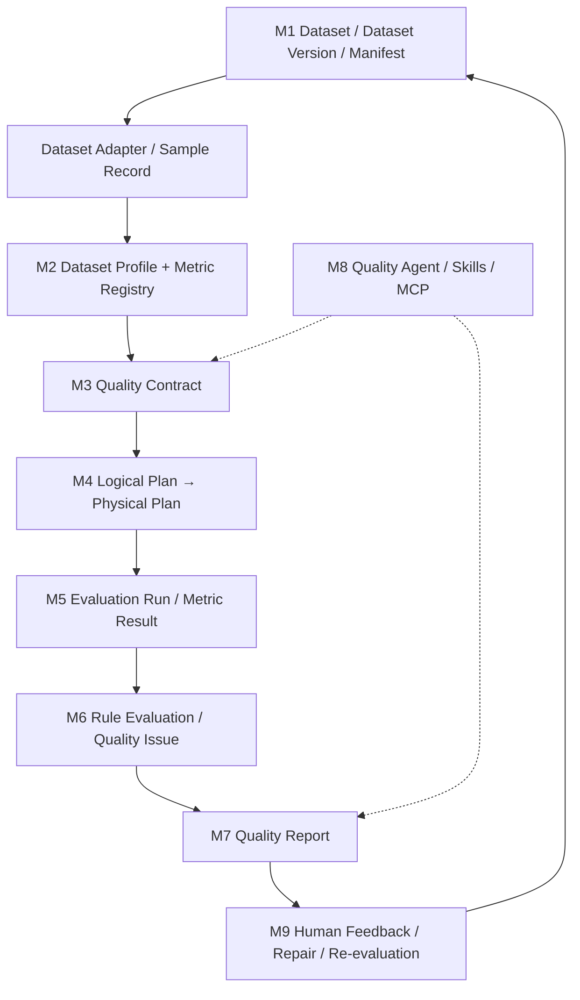

# 多模态数据集质量评测系统｜Phase 0 → Phase 1 开发交接文档

> 整理日期：2026-10-19  
> 状态：用户已确认 Step 4.10 测试通过，准备进入 Phase 1。  
> **阅读顺序**：先读 `pm-v0.md`（产品与业务设计），再读 `rd-v0.md`（技术落地方案），最后读本交接文档（实际进度、已达成决策和待办）。  
> **重要边界**：本文件基于当前对话中已讨论的实施方案、用户反馈及提供的两份文档整理；没有访问用户实际 Git 仓库、代码提交或 CI，因此“完成”指用户报告测试通过，不表示已独立审计代码。

## 0. 新对话框的启动指令（可直接复制）

我正在从零开发“面向多模态 AI 数据集的可扩展智能质量评测系统”。请先阅读我上传的 `pm-v0.md`、`rd-v0.md` 和 `phase0-to-phase1-handoff.md`。其中 PM 文档规定 M1–M9 业务模块、核心对象、指南指标及业务闭环；RD 文档规定技术栈、架构、数据协议、阶段计划；交接文档说明 Phase 0 已做工作和实施中的调整。**不要把 PM 文档里的备选技术选型覆盖 RD 文档的正式选型，前端必须使用 React + TypeScript + Vite + Ant Design。** 当前 Step 4.10 已经测试通过，请从 **Phase 1：数据接入与画像** 开始，先梳理 Phase 1 可交付物和第一步具体任务，再按一次一小步的方式带我编码：说明业务目的、模块归属、文件路径、代码、原理、运行/测试命令、预期结果及验收标准。首个真实数据源是 MySQL `jhsjk_article`，但系统必须保持多模态扩展性。先检查现有工程文件或让我提供相关代码，不能假设我的实际代码与历史示例完全一致。

## 1. 两份设计文档的分工（强约束）

- **`pm-v0.md`**：产品定位、M1–M9 模块、对象职责、指标指南、完整业务流程、MVP 场景、业务约束。回答“做什么、为什么做、业务规则是什么”。
- **`rd-v0.md`**：正式技术落地方案，包含 React 前端、Python 3.12、FastAPI、PostgreSQL、MinIO、Celery/Redis、工程目录、对象协议、Phase 0–4 交付及验收。回答“如何工程化实现”。
- **本文件**：当前开发进度、代码位置、实现过程中确定的具体约定、偏差和风险。不能取代两份原文档。
- 若三者冲突，先区分“产品需求 vs 技术实施 vs 实际代码”，明确指出冲突，提出选择并征求确认；不得静默重写既有设计。

## 2. 产品目标与业务主线

系统定位：高质量 AI 数据集平台的**横向、可扩展质量评测服务**，支持结构化数据、文本、图像、音频、视频和组合模态；数据集/样本/字段/模态级评测；内置与自定义指标、领域规则、模型辅助评测；人工、平台 API、未来 Agent/MCP 统一调用。**v0 用中文文章结构化文本跑通端到端，但不是文章专用检测器。**

完整链路：



M1 生命周期/标准化；M2 画像及指标/计算器注册；M3 质量契约；M4 逻辑/物理计划与任务管理；M5 确定性评测引擎；M6 规则判定与问题检测；M7 报告与可视化；M8 Agent 智能辅助；M9 人工反馈、修复、复评。

**核心不变量**：
1. 评测对象是**固定的 Dataset Version**，不是动态源表；发布版本不可变，修复生成新版本。
2. Manifest 管身份、来源、文件、格式、Schema Mapping、注册信息；不存完整样本和质量分数。
3. Sample Record 保留原始内容、语义角色、标注、来源血缘；标准化不覆写原始数据；失败写 reject 证据。
4. Dataset Profile 仅描述事实，不直接下合格结论。
5. 指南标准指标/实际注册指标/Calculator Implementation/Contract Item 分层；同一标准编码可以对应多个实际指标和实现。
6. Contract 定义口径、阈值、适用范围和实现约束；Logical Plan 描述计算需求及依赖，Physical Plan 绑定计算器、模型版本、参数和执行策略。
7. Metric Result（事实）、Rule Evaluation（判定）、Quality Issue（异常与证据）、Quality Report（汇总）严格分离；计算失败 ≠ 质量不合格。
8. 人工反馈追加记录，不覆盖历史事实；Agent 推荐、解释、诊断，**不得自行篡改指标值、判定或自动执行高风险修复**。
9. 修复后用新版本复评，质量改善与下游模型效果改善需分别验证。

### 指南指标要求

必须完整注册并覆盖 PM 中的指南编号和权重：说明文档 **0101–0104**，数据质量 **0201–0208**（0208 下含文本 02080101–02080107、图像 02080201–02080204、视频 02080301–02080306、音频 02080401–02080406），模型应用 **0301–0305**。实际实现可以分批。未实现或证据不足不得算 PASS；适用性状态区分 `NOT_APPLICABLE` / `NOT_EVALUATED`，并与规则判定 `PASS` / `FAIL` / `UNKNOWN` / `SKIPPED` 分开建模。请以 PM 原文的指标描述和权重为准，不从本摘要推导细则。

## 3. 正式技术路线（以 RD 文档为准）

| 组件 | 决定的技术 |
|---|---|
| 前端 | **React + TypeScript + Vite + Ant Design**；后续有 `apps/web`，不要改成 Streamlit |
| 后端 | Python **3.12**、FastAPI、Pydantic v2 |
| ORM/迁移 | SQLAlchemy 2、Alembic |
| 元数据库 | PostgreSQL 16 |
| 对象存储 | MinIO / S3 API 兼容存储；本地开发使用 `pgsty/silo` 兼容服务（历史 MinIO 镜像获取曾遇到 401） |
| 队列与异步 | Redis 7 + Celery 5；按 RD 阶段逐步接入，不能因暂未实现就取消选型 |
| 数据处理 | PyArrow、Polars；JSONL/Parquet → 标准化 Parquet |
| 编排 | 自研轻量 DAG、Pipeline/Stage/Executor；不引入独立大型工作流引擎 |
| 测试 | pytest、Ruff、uv；RD 还规划 testcontainers、Playwright |
| 可观测性 | OpenTelemetry、Prometheus、结构化日志（后续实施） |
| 部署 | Docker Compose，本地 Mac 开发，未来 Linux 服务器部署 |

RD 原定 v0 单版本上限 100 万条、20 GB；单机多进程、异步任务；不实现分布式 Spark/Ray/K8s、完整图像/音视频实际计算、自动高风险修复、在线模型效果验证和默认 LLM 质量门禁。v0 要支持 JSONL/Parquet，**MySQL 是新增的首个真实接入 Adapter**，不应取代通用文件 Adapter 的验收要求。

### 重要的尚未统一点

- RD 设计内部 ID 使用 **UUIDv7**、`version_no` 递增；Phase 0 实际教学代码多使用 `uuid4()` 与字符串 `version="v1"`。**不要假装已经一致**；Phase 1 开始前应决定是否迁移/兼容，以及是否已产生真实数据。
- RD 的 Sample Record v1 用 `sample_id`、`content.text`、`annotations`、`source`、`lineage`，并建议 Parquet；PM 的 Sample Record 用 `id`、`rid`、`data_content[{content_id,media_type,role,content}]`、`annotation` 等。**这是待正式决策的协议差异**，尤其要保留文章 title/summary/HTML/plain-text 的不同语义角色。不能仅因为 RD 的 `content.text` 简化格式而丢失 PM 所要求的信息。建议 Phase 1 先做 ADR + Pydantic Schema，并定义 v0 文本便捷访问字段或投影。
- RD 的 DatasetVersion 包含 `version_no/status/manifest_uri/raw_fingerprint/normalized_uri`；Step 4.10 实现示例只有 `version/status/created_at/published_at`，Manifest 单独 JSONB 表。应明确是否需要补齐存储 URI、快照指纹与版本号，且**不能将 4.10 的简化 ORM 当成完整生命周期实现**。
- RD 的 `datasets` 预期有 `owner_id`、项目级唯一约束，Phase 0 实际 ORM 只有 `name/description/modality` 等。权限/归属字段尚未实现。
- PM 示例 Manifest 与 RD Manifest 的字段组织可能有差异。发布协议应根据两份文档统一，不要静默任选一份。

## 4. Phase 0 开发历史及确认状态

以下根据当前对话记录整理；用户已确认 **Step 4.10 测试通过**，但未提供 Git 提交哈希或最终源码审计。

| 步骤 | 内容 | 状态 |
|---|---|---|
| Step 1 | `uv init --lib --python 3.12 --no-workspace`，FastAPI、uvicorn、Pydantic Settings、pytest/httpx、Ruff | 已开展，早期测试通过 |
| Step 2 | `src/qa_eval/config.py` 配置；`apps/api/main.py` FastAPI 应用工厂；`/api/v1/health` | 已开展，曾有 5 个测试通过 |
| Step 3 | `deploy/docker-compose.yml`：PostgreSQL 16、Redis 7、S3 兼容对象存储 | 已搭建 |
| Step 4.1–4.7 | SQLAlchemy 基础、`datasets` ORM、数据库 Session、Alembic 迁移 | 已开展，首个 revision `44e79f55f176` |
| Step 4.8 | 独立 `qa_eval_test` 数据库、测试 Session/savepoint/外层 rollback，Dataset 集成测试 | 已指导并继续推进 |
| Step 4.9 | Dataset Domain Entity、Repository Port、SQLAlchemy Repository、DatasetService、FastAPI 数据集 API、单测/集成测试 | 已指导；用户随后继续到 4.10，未在当前对话提供单独测试日志 |
| **Step 4.10** | DatasetVersion 领域状态机、DatasetManifest Pydantic、两张 ORM 表、Alembic 迁移及测试 | **用户明确确认测试通过** |

**状态解释**：4.10 已通过 ≠ Phase 0 原 RD 的全部交付项都已核验。RD 的 Phase 0 还列出统一错误、日志、JWT 开发适配、S3/Redis/PG 健康检查、OpenAPI 基线、CI、一键全栈启动等；当前对话没有逐项通过记录。为了不继续拖延，可以把这些列入“工程补齐 backlog”，不妨碍以最小可运行链路进入 Phase 1，但需要在 v0 正式验收前补齐。

### 已知的实际文件/接口（以仓库现状为准）

```text
src/qa_eval/
  config.py
  domain/entities/dataset.py
  domain/entities/dataset_version.py
  domain/entities/dataset_manifest.py
  domain/repositories/dataset_repository.py
  application/services/dataset_service.py
  infrastructure/db/base.py
  infrastructure/db/session.py
  infrastructure/db/models/dataset.py
  infrastructure/db/models/dataset_version.py
  infrastructure/db/models/dataset_manifest.py
  infrastructure/db/repositories/sqlalchemy_dataset.py
apps/api/
  main.py
  dependencies.py
  routes/datasets.py
migrations/
  env.py
  versions/...
tests/
  unit/test_dataset_service.py
  unit/test_dataset_version.py
  integration/conftest.py
  integration/test_dataset_db.py
  integration/test_dataset_repository.py
  integration/test_dataset_version_db.py
deploy/docker-compose.yml
pyproject.toml
.env / .env.example
```

这些路径来自历史代码指导，不代表已逐个读取当前磁盘上的实际仓库文件。新对话框请用户提供 `tree`、相关源码和 `alembic current`，遇到不同目录应以仓库实际为准。

**已讨论的 Dataset API**：

```http
POST /api/v1/datasets
GET  /api/v1/datasets
GET  /api/v1/datasets/{dataset_id}
```

同一路径通过 HTTP Method 区分创建和列表，是有意采用的 REST 资源式风格；**不必改成** `/register`、`/list`。复杂业务动作可用子资源或 `/publish` 等命令路径。

### Step 4.10 领域状态机（当前教学实现）

`DRAFT → REGISTERED → PUBLISHED`，`DRAFT/REGISTERED → FAILED`（后者在先前设计图中规划，但示例实体只实现 `mark_registered()` 与 `publish()`，**未见失败转换方法**）。`PUBLISHED` 是正式评测可用版本；不可原地修改。Step 4.10 ORM 约束 `(dataset_id, version)` 唯一、Manifest 对 Version 一对一。JSONB Manifest 有 SHA-256 字段，但**尚未实现完整的校验和生成、文件核验、发布事务与不可变性数据库强约束**，这是 Phase 1 任务。

### 测试数据库和环境

- 开发库：`qa_eval`；测试库：`qa_eval_test`。`QA_EVAL_DATABASE_URL`、`QA_EVAL_TEST_DATABASE_URL` 分离。
- 本地 PostgreSQL 曾用 127.0.0.1:5432，Redis 6379，S3 9000/9001；不要在交接文档中保存真实密码或密钥。
- 集成测试 Fixture 通过 `Session(bind=connection, join_transaction_mode="create_savepoint")` 配合外层事务回滚，使业务代码即使 `commit()`，测试数据也不应留存。
- 主要命令：`uv run pytest -v`、`uv run ruff check .`、`uv run alembic check`；迁移需分别对开发库和测试库执行。
- 4.10 的测试通过是用户确认；最终测试数量、覆盖率、迁移 revision ID 需新对话框读取实际输出。

## 5. 首个真实数据集：MySQL `jhsjk_article`

- **数据源**：MySQL 表 `jhsjk_article`。
- **样本粒度**：一篇文章 = 一条 Sample Record。
- **源数据主键**：`id`（UUID；PM 示例为 32 位无连字符表示）；`article_id` 是站点文章编号，**不是全局唯一主键**。
- **业务字段**：`article_id`、`title`、`url`、`pub_date`、`origin_name`、`summary`、`content`（保留 HTML）、`plain_text_content`、`create_time`；还有 `id`。
- **评测对象**：文章元数据、HTML 原文、纯文本正文、摘要。HTML 与纯文本必须分别保留，不能在标准化时静默替换；title、summary 等保留语义角色。
- **快照要求**：每次评测绑定固定 MySQL 数据快照 → 文件（JSONL/Parquet）→ 校验和 → Dataset Manifest → 不可变 Dataset Version → 标准化 Sample Records；源表后续变化不得改变历史评测结果。
- **待验证**：实际 MySQL DDL、`id` 的物理存储类型、时区/字符集、索引、是否存在重复 ID、行数、单行 HTML 大小、快照一致性方案、数据库连接方式、权限、敏感数据与网络访问限制。**先读真实 DDL 再决定抽取排序/分页/增量策略**。
- **重要**：PM 中的示例文章只是样例，不代表已经连接 MySQL 或获取了真实表 DDL。

## 6. Phase 1：数据接入与画像（以 RD 原定交付为主）

RD 文档 Phase 1 的明确交付：
1. Dataset/Version API、预签名上传、Manifest 校验。
2. JSONL/Parquet Adapter、reject 机制、标准化 Parquet。
3. 基础画像及数据集页面。
4. 完成标志：两种格式均可注册、标准化、画像，坏记录可定位且不阻断允许范围内的任务。

结合首个 MySQL 场景，建议在上述范围内增加 `MySQLArticleAdapter` 和一致性快照抽取（**新增接入适配器，不替代 JSONL/Parquet**）。建议按可验证的垂直切片推进：

**P1-0｜启动核对（建议先做）**：读取实际仓库目录、当前 Alembic head、Phase 0 ORM 与 Pydantic、配置、现有测试；核对 PM/RD 标识和 Sample Record 协议差异；形成一份最小 ADR，不要直接重构所有代码。

**P1-1｜数据源与标准化协议**：确认 MySQL DDL、Sample Record v1 统一 Schema、字段语义角色、来源血缘、稳定 sample_id、时间字段及 reject 格式；同时保留通用 JSONL/Parquet 入口。

**P1-2｜快照与对象存储**：Source Connector → 一致性读取 → 原始快照 JSONL/Parquet → S3 对象存储 → 文件 checksum、行数、源指纹、URI；不在 PostgreSQL 逐条存原始大文本。

**P1-3｜Manifest + 版本发布**：实现 Manifest 构建、Schema 验证、checksum、草稿/注册/发布状态、数据库与对象存储引用一致性、失败恢复/幂等、发布后不可变；完成 Dataset Version API。

**P1-4｜Adapter 与标准化**：`jhsjk_article` → Sample Record，保留 HTML/纯文本/摘要等角色；生成标准化 Parquet；坏记录 reject + 来源定位；补充通用 JSONL/Parquet Adapter 测试。

**P1-5｜Dataset Profile**：记录数、Schema/模态、字段缺失、文本长度分布、语言/标签分布等轻量画像；画像是事实描述而非质量结论；同一版本可因算法升级重算画像。

**P1-6｜API + React 最小页面 + E2E**：版本、Manifest、画像、样本预览；用真实文章和小型 JSONL/Parquet fixtures 验证。UI 使用 React，不用 Streamlit。

以上 P1-0～P1-6 是交接时建议的**教学拆解**，不是冒充 RD 已有的官方子步骤。实际编码应每次只推进一个可运行切片。

### Phase 1 重要验收用例

- 同一逻辑 Dataset 注册 v1、v2，Dataset ID 不变，Version ID 不同；同一 `(dataset_id, version)` 不允许重复。
- 已发布版本、Manifest 和文件快照不可被原地更改；旧评测始终指向原快照。
- 源表中相同 `article_id` 不会导致不同样本错误合并；使用实际 `id` 或经验证的稳定标识。
- HTML、plain text、title、summary 在 Sample Record 中语义明确，能追溯到 MySQL 源行。
- JSONL/Parquet 与 MySQL 三种来源复用标准化接口；失败记录可定位、可计数。
- Snapshot checksum、Manifest checksum 各自独立；对象写入后校验，再提交最终 URI 引用。
- Dataset Profile 不写质量 PASS/FAIL；重跑能关联算法版本和配置。
- 所有集成测试在 `qa_eval_test` 隔离执行；至少验证一次端到端 API → 文件 → Manifest → 标准化 → 画像。

## 7. 未来阶段与边界

- **Phase 2**：M2 Metric/Calculator Registry + M3 Contract + M4 Logical/Physical Plan；完整注册指南指标，按适用性筛选，实现约束/依赖校验与物理 DAG。
- **Phase 3**：M5 Executor/Metric Result + M6 Rule Evaluation/Issue，Celery、重试、幂等、确定性计算与异常证据；不要混淆计算失败和质量不达标。
- **Phase 4**：M7 报告、React UI、质量门禁、审计/可观测性，端到端验收。
- **M8 Agent/MCP/Skills 与 M9 反馈修复**：PM 是长期产品能力，RD 将复杂 Agent 与完整修复闭环留给后续演进；v0 不要为了 Agent 而破坏确定性引擎。

## 8. 用户对教学与协作的要求

1. 使用中文，**从零、逐步、工程化教学**；既讲业务原因，也讲底层技术原理与设计模式的收益，不只贴代码。
2. 每步说明：所属 M1–M9 模块、核心输入输出、需要改/新建的**准确文件路径**、完整可运行代码、命令、预期输出、测试与验收标准。
3. 不一次性堆积过多未验证步骤；用户执行并反馈后再继续；遇到报错按真实日志诊断。
4. 尊重用户已经做出的架构决定，特别是 **React 前端**、PM/RD 文档分工、M1–M9 核心线路和完整指南指标；不要偏离成“文章检测工具”或通用 CRUD 教程。
5. 使用清晰的 Repository/Application Service/Adapter/Domain 分层，保持接口稳定；跨模块通过 application service 或 domain port，禁止跨模块直接依赖别的模块 ORM。
6. 所有正式质量结论都应可追溯至 Dataset Version、Contract、Calculator/模型参数、证据；不要用 LLM 主观解释覆盖客观计算。
7. 及时区分“设计建议”“已写代码”“测试通过”“尚未验证”；**不要臆造 Git 提交、测试覆盖率、迁移 ID 或部署状态**。
8. 不要让 Phase 1 再陷入无限基础设施搭建；优先实现真实数据的纵向闭环，同时记录技术债。

## 9. 新对话框首次需要确认的最少信息

1. 上传 `pm-v0.md`、`rd-v0.md`、本交接文档。
2. 提供当前仓库的目录树（如 `find src apps tests migrations -maxdepth 4 -type f | sort`）、`uv run alembic current`、`uv run pytest -q` 的结果；不必一次性贴全仓库代码。
3. 提供 **MySQL `SHOW CREATE TABLE jhsjk_article`**（可脱敏）及少量匿名化样本字段类型/长度；不要提供数据库密码、真实连接凭据或敏感文本。
4. 如 Step 4.10 的最终实现与本交接中示例不同，以实际代码为准，并在 Phase 1 第一步调整方案。

---

**交接结论**：用户确认 Step 4.10 测试通过，可以开始 Phase 1。目标不是继续增加 Phase 0 的抽象层，而是以真实 MySQL `jhsjk_article` 为首个业务场景，完成不可变数据快照、Manifest、Sample Record、基础画像及 React 可视化，同时保留 JSONL/Parquet 通用数据接入和未来多模态评测的稳定扩展接口。
