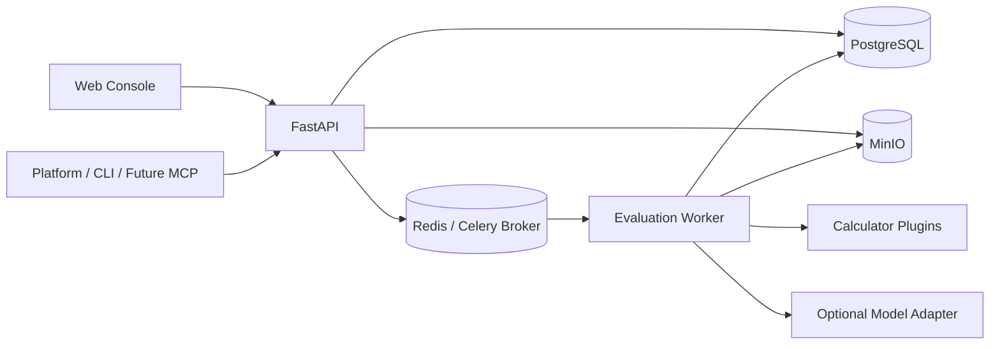
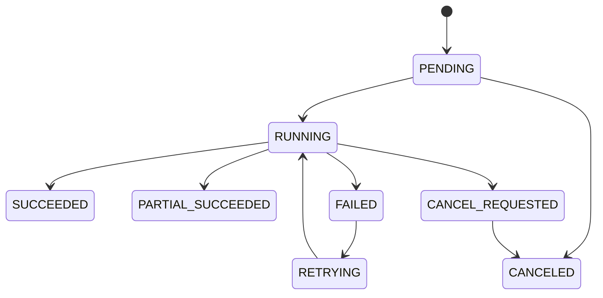

# 多模态数据集质量评测系统技术落地方案（v0）

> 文档状态：可进入开发  
> 对应产品方案：`plan/v0/pm-v0.md`  
> v0 目标：以 JSONL/Parquet 结构化文本数据为对象，跑通“注册—标准化—画像—契约—计划—执行—判定—问题—报告”的完整闭环，并为多模态、分布式执行和 Agent 接入保留稳定扩展点。

## 1. 范围与交付边界

### 1.1 v0 必须交付

1. 通过本地上传或对象存储 URI 注册数据集，生成不可变的数据集版本。
2. 支持 JSONL、Parquet；字段可映射为 `id`、`text`、`label`、`metadata`、`source` 等统一语义角色。
3. 生成基础画像：记录数、字段类型、缺失率、文本长度、语言分布和标签分布。
4. 指标与计算器注册，质量契约草稿、校验、发布和版本管理。
5. 编译逻辑 DAG 和本地物理执行计划，支持依赖去重、分批计算、失败重试和结果幂等写入。
6. 支持首批确定性文本指标，生成样本级和数据集级结果。
7. 按契约完成 PASS / FAIL / UNKNOWN / SKIPPED 判定，生成可定位到样本的质量问题。
8. 提供结构化报告、问题分页查询、运行追踪和 JSON 报告导出。
9. 提供 REST API 和异步任务接口，供人工界面、平台服务和后续 MCP Tools 共用。
10. 提供最小管理页面：数据集版本、契约、运行、报告四类页面。

### 1.2 v0 不实现

- 图像、音频、视频的实际解码及指标计算。
- Spark/Ray/Kubernetes 分布式执行和自动弹性伸缩。
- 自动修改数据、自动发布契约或自动执行修复。
- 在线训练效果验证、完整标注平台、复杂租户计费。
- LLM 自动评分作为质量门禁的默认依据。
- 周期调度和数据变更触发；v0 仅预留触发接口，支持手动运行和发布前同步等待式门禁。

### 1.3 核心非功能目标

| 项目 | v0 目标 |
|---|---|
| 数据规模 | 单版本不超过 100 万条、原始文件不超过 20 GB |
| 执行方式 | 单机多进程，任务异步执行 |
| API 可用性 | 单实例开发环境；生产建议至少 2 个 API 副本 |
| 可追溯性 | 任一规则结论可追溯到数据版本、契约版本、计算器版本、参数和证据 |
| 幂等性 | 注册、计划编译、运行创建和结果写入均具备业务幂等键 |
| 安全性 | 原始文本默认不写应用日志；证据片段可配置脱敏和长度上限 |
| 可观测性 | API、队列任务和单个 stage 均具备 trace/run/stage 标识 |

## 2. 总体技术架构

### 2.1 技术选型

| 层次 | 选型 | 用途 |
|---|---|---|
| API | Python 3.12、FastAPI、Pydantic v2 | REST API、参数与结果 Schema |
| ORM / 迁移 | SQLAlchemy 2、Alembic | 元数据和事务管理 |
| 数据库 | PostgreSQL 16 | 元数据、状态、指标事实、规则结果、问题索引 |
| 对象存储 | MinIO（S3 API） | 原始文件、标准化数据、画像、计划、证据和报告 |
| 异步任务 | Celery 5、Redis 7 | 任务分发、重试；Redis 不保存业务事实 |
| 数据计算 | PyArrow、Polars | JSONL/Parquet 扫描、批处理、聚合 |
| 文本能力 | regex、langdetect/fastText 可替换适配器 | v0 基础文本指标 |
| 前端 | React、TypeScript、Vite、Ant Design | 最小管理控制台 |
| 可观测性 | OpenTelemetry、Prometheus、结构化日志 | 链路、指标和日志关联 |
| 测试 | pytest、testcontainers、Playwright | 单元、集成和端到端测试 |
| 本地部署 | Docker Compose | PostgreSQL、MinIO、Redis、API、Worker、Web |

选择 Python 是为了复用数据处理和后续模型生态。PostgreSQL 保存可查询的小型事实与状态；大数组、原始样本和报告正文保存至对象存储，避免数据库膨胀。v0 不引入独立工作流引擎，DAG 编排由应用层实现，任务调度由 Celery 承担。

### 2.2 运行时组件



### 2.3 工程目录

```text
qa-eval/
  apps/
    api/                    # FastAPI 启动、路由、依赖注入
    worker/                 # Celery 启动与任务入口
    web/                    # React 管理页面
  src/qa_eval/
    domain/                 # 实体、值对象、枚举、领域规则
    application/            # 用例服务、事务边界、DTO
    infrastructure/
      db/                   # SQLAlchemy model/repository
      object_store/         # S3/MinIO adapter
      queue/                # Celery adapter
      observability/
    modules/
      datasets/             # M1
      profiling/            # M2 profile
      registry/             # M2 metric/calculator registry
      contracts/            # M3
      planning/             # M4
      execution/            # M5
      quality/              # M6
      reporting/            # M7
    plugins/
      adapters/             # JSONL/Parquet DatasetAdapter
      calculators/          # 指标计算器插件
      detectors/            # 问题检测器插件
  migrations/
  configs/
    metrics/                # 内置指标声明
    contract_templates/     # 契约模板
  tests/
    unit/
    integration/
    e2e/
    fixtures/
  deploy/docker-compose.yml
  pyproject.toml
```

模块只通过 application service 或定义在 domain 中的端口交互，禁止跨模块直接访问对方 ORM model。

## 3. 核心领域模型

### 3.1 统一标识和版本规则

- 主键使用 UUIDv7，API 中统一为字符串。
- `Dataset` 是稳定身份；`DatasetVersion.version_no` 在同一 Dataset 内递增且不可重复。
- 已发布的 DatasetVersion 和 QualityContractVersion 不允许原地修改，只能创建新版本。
- 所有时间使用 UTC 存储，API 输出 RFC 3339；UI 按用户时区展示。
- 业务对象带 `created_at`、`created_by`；需要更新的对象带 `updated_at`。
- JSON Schema 版本字段统一为 `schema_version`，v0 值为 `1.0`。

### 3.2 Sample Record v1

标准化数据按 Parquet 分片存储，不逐条写入 PostgreSQL。

```json
{
  "schema_version": "1.0",
  "dataset_version_id": "uuid",
  "sample_id": "source-id-or-generated-id",
  "content": {
    "text": "sample text"
  },
  "annotations": {
    "label": "category-a"
  },
  "metadata": {
    "language_declared": "zh",
    "captured_at": "2026-01-01T00:00:00Z"
  },
  "source": {
    "source_uri": "s3://bucket/raw/file.jsonl",
    "source_row": 42,
    "source_record_id": "external-42"
  },
  "lineage": {
    "adapter": "jsonl_text@1.0.0",
    "input_fingerprint": "sha256:..."
  }
}
```

约束：

- `sample_id` 在数据集版本内唯一。未提供时取“文件指纹 + 行号”的稳定哈希，重跑不得变化。
- `content.text` 是 v0 唯一必选评测内容；字段映射失败的记录写入独立 reject 文件。
- 原字段可按配置保留到 `metadata.raw_fields`，默认关闭以控制存储量。
- 标准化产物目录：`datasets/{dataset_id}/versions/{version_id}/normalized/part-*.parquet`。

### 3.3 主要数据库表

| 表 | 关键字段 | 说明与约束 |
|---|---|---|
| `datasets` | `id, name, description, owner_id` | 数据集稳定实体，`(owner_id,name)` 唯一 |
| `dataset_versions` | `id, dataset_id, version_no, status, manifest_uri, raw_fingerprint, normalized_uri` | `(dataset_id,version_no)` 唯一；发布后不可变 |
| `dataset_profiles` | `id, dataset_version_id, profiler_name, profiler_version, profile_uri, summary_json` | 同版本允许多个画像算法版本 |
| `metric_definitions` | `id, metric_key, version, scope, output_type, direction, definition_json` | `(metric_key,version)` 唯一 |
| `calculator_implementations` | `id, calculator_key, version, entrypoint, input_schema, output_schema, capability_json, code_digest, enabled` | 计算器实现注册表 |
| `metric_calculator_bindings` | `metric_definition_id, calculator_id, priority, constraint_json` | 指标和实现多对多 |
| `quality_contracts` | `id, name, owner_id` | 契约稳定实体 |
| `quality_contract_versions` | `id, contract_id, version_no, status, contract_json, fingerprint` | `DRAFT/PUBLISHED/RETIRED`；发布后不可变 |
| `evaluation_plans` | `id, dataset_version_id, contract_version_id, logical_plan_uri, physical_plan_uri, fingerprint` | 相同输入和编译器版本可复用 |
| `evaluation_runs` | `id, plan_id, trigger_type, status, input_fingerprint, started_at, finished_at, error_json` | 一次实际执行 |
| `stage_runs` | `id, run_id, node_id, attempt, status, calculator_id, input_fingerprint, output_uri, stats_json, error_json` | `(run_id,node_id,attempt)` 唯一 |
| `metric_results` | `id, run_id, metric_key, metric_version, scope, subject_id, value_num, value_text, value_json, status, evidence_uri` | 一个 value 列非空；支持样本/分组/数据集 |
| `rule_evaluations` | `id, run_id, contract_item_key, subject_id, status, observed_json, reason_code` | 判定事实 |
| `quality_issues` | `id, run_id, issue_key, category, severity, scope, subject_id, status, evidence_uri, dedup_key` | `(run_id,dedup_key)` 唯一 |
| `quality_reports` | `id, run_id, status, summary_json, report_uri, generated_at` | 每个 run 保留报告版本 |
| `outbox_events` | `id, aggregate_type, aggregate_id, event_type, payload_json, status` | 事务型异步事件 |

高基数样本指标默认以 Parquet 保存，对 PostgreSQL 只写聚合结果、失败结果及问题样本索引。`metric_results` 中样本级明细是否入库由指标的 `persistence_policy` 决定。

### 3.4 对象存储布局

```text
s3://qa-eval/
  datasets/{dataset_id}/versions/{version_id}/
    raw/{file_name}
    manifest.json
    normalized/part-*.parquet
    rejected/part-*.jsonl
    profiles/{profile_id}.json
  runs/{run_id}/
    plans/logical.json
    plans/physical.json
    stages/{node_id}/attempt-{n}/part-*.parquet
    evidence/{issue_or_metric_id}.json
    reports/{report_id}.json
```

写入使用“临时对象 → 校验 checksum → 提交最终 URI”；数据库只在对象提交成功后引用最终 URI。

## 4. Manifest、指标与契约协议

### 4.1 Dataset Manifest v1

```yaml
schema_version: "1.0"
dataset_id: "uuid"
dataset_version_id: "uuid"
name: demo_qa
modality: text
format: jsonl
source:
  uri: s3://qa-eval/.../raw/train.jsonl
  sha256: "..."
schema_mapping:
  sample_id: id
  content.text: question
  annotations.label: category
  metadata.captured_at: created_at
declared_usage:
  task_type: question_answering
  language: zh
documentation:
  license: Apache-2.0
  source_description: "..."
```

上传请求须给出源格式和字段映射。服务校验文件存在、格式可读、必需映射存在，并计算原始输入指纹：`sha256(file_checksums + canonical_manifest)`。

### 4.2 Metric Definition v1

```yaml
metric_key: data.text.non_empty_ratio
version: 1.0.0
name: 文本非空率
scope: dataset
subject: content.text
output:
  type: number
  minimum: 0
  maximum: 1
direction: higher_is_better
dependencies:
  - feature.text.is_empty@1
applicability:
  modalities: [text]
  required_fields: [content.text]
persistence_policy: aggregate_and_failures
```

`Metric Definition` 表达计算语义；`Calculator Implementation` 表达实现。指标定义变更语义时必须提升版本，计算器仅优化实现时提升计算器版本。

### 4.3 Calculator 插件接口

```python
class Calculator(Protocol):
    descriptor: CalculatorDescriptor

    def validate(self, context: ValidationContext) -> list[ValidationError]: ...

    def calculate_batch(
        self,
        batch: "pyarrow.RecordBatch",
        context: CalculationContext,
    ) -> CalculationOutput: ...

    def aggregate(
        self,
        partials: Iterable[CalculationOutput],
        context: CalculationContext,
    ) -> CalculationOutput: ...
```

插件通过 Python entry point `qa_eval.calculators` 加载。`descriptor` 必须声明计算器 key/version、支持的指标、输入字段、参数 Schema、是否确定性、资源需求和输出 Schema。加载时校验重复 key、版本格式及输出兼容性；运行时禁止插件直接操作业务数据库。

### 4.4 Quality Contract v1

```yaml
schema_version: "1.0"
name: structured-text-baseline
applicability:
  modality: text
  task_types: [classification, question_answering, generic]
items:
  - key: text_non_empty_gate
    metric:
      key: data.text.non_empty_ratio
      version: 1.0.0
    scope: dataset
    parameters:
      trim_whitespace: true
    implementation_constraints:
      deterministic: true
    rule:
      operator: gte
      threshold: 0.99
    severity: error
    on_missing: unknown
  - key: text_length_warning
    metric:
      key: data.text.too_short_ratio
      version: 1.0.0
    scope: dataset
    parameters:
      min_chars: 10
    rule:
      operator: lte
      threshold: 0.05
    severity: warning
    on_missing: skipped
gate:
  fail_when:
    - any_item: {severity: error, status: FAIL}
  unknown_policy: fail
```

v0 规则操作符限定为 `gt/gte/lt/lte/eq/ne/between/in/not_in`。不允许在数据库执行用户自定义表达式或任意代码。组合规则以受限 AST 表示，支持 `all/any/not`，最大嵌套 5 层。

### 4.5 契约发布校验

发布前依次校验：

1. JSON Schema 与业务字段合法。
2. item key 在契约内唯一，指标版本存在且启用。
3. 参数符合指标及候选计算器 Schema。
4. 阈值类型与指标输出类型兼容。
5. 指标适用于声明模态和任务，依赖无环。
6. 至少存在一个满足实现约束的已启用计算器。
7. gate 引用的严重程度和状态有效。

失败返回稳定错误码和 JSON Pointer，例如 `CONTRACT_METRIC_NOT_FOUND`、`/items/0/metric/version`。

## 5. 评测计划与执行

### 5.1 逻辑计划

逻辑节点类型：

- `SOURCE_SCAN`：扫描标准化 Parquet。
- `FEATURE`：生成可复用中间特征。
- `METRIC`：计算样本级或批级指标。
- `AGGREGATE`：合并分片为数据集/分组指标。
- `RULE`：确定性规则判定。
- `ISSUE`：从失败结果或 detector 输出生成问题。
- `REPORT`：生成结构化报告。

编译步骤：解析契约 item → 展开指标依赖 → 以 `(metric/feature key, version, canonical params)` 去重 → 拓扑排序 → 检查循环与不可满足依赖 → 输出规范化 JSON。逻辑计划指纹为规范化 JSON 的 SHA-256。

### 5.2 物理计划

物理编译器为每个 FEATURE/METRIC 节点：

1. 按模态、字段、参数、确定性和资源要求过滤计算器。
2. 优先选择契约指定版本，其次按 binding priority 和语义版本排序。
3. 固化 calculator key/version、代码 digest、镜像/环境版本、批大小和资源限制。
4. 合并相同扫描与公共特征，生成 stage 边界。
5. 记录编译器版本；任何绑定变化都会产生新的物理计划指纹。

v0 默认批大小 10,000 条，可按记录平均字节数下调；Worker 单进程内存软上限建议 2 GB。

### 5.3 状态机



- `PARTIAL_SUCCEEDED` 表示非关键 item 失败但仍生成报告；是否通过门禁由报告结论单独表示。
- 运行状态和质量结论分开：`run.status=SUCCEEDED` 不代表 `report.gate_status=PASS`。
- stage 通过数据库行锁领取；Worker 以心跳续租。租约过期后允许重新领取。
- 默认最大 3 次尝试，指数退避；参数错误、Schema 不兼容等不可重试错误直接失败。

### 5.4 执行一致性和缓存

- 创建运行需携带 `Idempotency-Key`；同调用方、同 key、同请求体返回原运行，请求体不同返回 409。
- stage 输入指纹：`dataset fingerprint + node spec + calculator code digest + dependency output fingerprints`。
- 仅 `deterministic=true` 且上次产物完整时允许跨 run 缓存复用。
- stage 输出先写临时对象并生成 manifest，再在数据库事务中提交状态；重复提交以唯一键消解。
- 数据库事务通过 outbox 投递队列事件，避免“已创建 run 但消息丢失”。
- 取消是协作式的：每个 batch 前检查取消标记，已提交事实不删除。

### 5.5 失败与缺失语义

| 情况 | Metric Result | Rule Evaluation | Run |
|---|---|---|---|
| 指标正常且有值 | `OK` | 按规则 PASS/FAIL | 继续 |
| 指标不适用 | `NOT_APPLICABLE` | SKIPPED | 继续 |
| 输入缺失且 `on_missing=unknown` | `MISSING` | UNKNOWN | 继续，按 gate 策略汇总 |
| 计算器异常且重试耗尽 | `ERROR` | UNKNOWN | 关键 item 则 FAILED，否则 PARTIAL_SUCCEEDED |
| 无有效样本导致分母为 0 | `MISSING` | UNKNOWN/SKIPPED | 继续 |

禁止把计算错误转换为 0 分或 FAIL，以避免把系统故障误报为数据质量问题。

## 6. v0 内置画像与指标

### 6.1 基础画像

| 输出 | 计算方式 |
|---|---|
| `record_count` | 成功标准化记录数 |
| `rejected_count` | 标准化失败记录数 |
| `field_schema` | Arrow 推断类型与可空性 |
| `field_missing_ratio` | null 或映射缺失数 / 总数 |
| `text_length` | 字符数的 min/max/mean/p50/p95/p99 |
| `language_distribution` | 抽样或全量语言识别分布，记录采样参数 |
| `label_distribution` | label 频次和比例，限制最大类别展示数 |

### 6.2 首批指标映射

| metric key | 级别 | 对应产品指标 | v0 算法 |
|---|---|---|---|
| `doc.required_section_ratio` | 数据集 | 0101—0104 | Manifest 文档字段命中数 / 配置要求数 |
| `data.format.valid_ratio` | 数据集 | 0201 | 可成功解析并通过字段 Schema 的记录数 / 原始记录数 |
| `data.annotation.valid_ratio` | 数据集 | 0203 | label 满足非空、类型和可选值约束的记录比例 |
| `data.structure.complete_ratio` | 数据集 | 0204 | 必需字段缺失数量在契约允许范围内的记录比例 |
| `data.text.non_empty_ratio` | 数据集 | 02080104/02080105 | trim 后非空文本记录比例 |
| `data.text.too_short_ratio` | 数据集+样本 | 02080104 | 字符数小于 `min_chars` 的比例 |
| `data.text.noise_ratio` | 数据集+样本 | 02080106 | 控制字符、乱码替代符、异常符号比例超过阈值的记录比例 |
| `data.text.exact_duplicate_ratio` | 数据集+样本对 | 02080103 | 文本规范化后 SHA-256 相同的重复记录占比 |
| `data.text.length_summary` | 数据集 | 辅助指标 | 字符长度描述统计 |
| `app.scale.satisfaction_ratio` | 数据集 | 0302 | `min(record_count/target_count, 1)` |
| `app.timeliness.valid_ratio` | 数据集 | 0303 | 时间字段在契约窗口内的记录比例 |

首期不声称自动覆盖 0202、0205、0206、0207、0301、0304 以及 PPL/知识密度/连贯度。这些指标需要领域模型、基准集或人工抽检，应以 `NOT_IMPLEMENTED` 明确呈现，不以占位分数参与总分。

### 6.3 归一化和重复定义

精确重复的默认规范化流程为 Unicode NFKC → 换行统一 → 首尾空白移除；是否折叠连续空白、大小写和标点由契约参数控制。保留原始样本不变，规范化文本仅作为计算中间特征。重复组选择最小 `sample_id` 为 canonical，其他样本生成 issue，证据只保存 ID 和摘要哈希，文本预览按权限获取。

### 6.4 总分策略

v0 报告默认展示各指标及 gate 结论，不默认生成单一总分。若模板启用加权总分：

- 仅对 `PASS/FAIL` 且有数值的适用项计算；`SKIPPED` 不进入分母。
- `UNKNOWN` 是否进入分母由契约明确配置，默认导致总分未知。
- 权重按契约内实际适用项重新归一化。
- 报告必须同时展示原权重、有效权重和缺失项，不能只展示总分。

## 7. API 设计

API 前缀 `/api/v1`，错误格式统一为：

```json
{
  "error": {
    "code": "CONTRACT_VALIDATION_FAILED",
    "message": "contract contains invalid items",
    "details": [{"path": "/items/0/metric", "reason": "not found"}],
    "request_id": "uuid"
  }
}
```

### 7.1 数据集与画像

| 方法 | 路径 | 说明 |
|---|---|---|
| `POST` | `/datasets` | 创建 Dataset |
| `POST` | `/datasets/{id}/versions` | 以对象 URI 或 multipart 创建版本；支持 Idempotency-Key |
| `GET` | `/datasets/{id}/versions` | 分页查询版本 |
| `GET` | `/dataset-versions/{id}` | 查询 Manifest、状态和产物 |
| `POST` | `/dataset-versions/{id}:normalize` | 启动标准化任务 |
| `POST` | `/dataset-versions/{id}:profile` | 启动画像任务 |
| `GET` | `/dataset-versions/{id}/profile` | 获取最新或指定 profiler 版本画像 |

创建版本返回 `202 Accepted` 和 operation/run 标识。上传建议使用预签名 URL，API 不代理大文件；开发环境可保留 multipart 小文件上传（上限 100 MB）。

### 7.2 注册中心与契约

| 方法 | 路径 | 说明 |
|---|---|---|
| `GET` | `/metrics` | 按模态、scope、状态筛选指标 |
| `GET` | `/metrics/{key}/versions/{version}` | 指标定义详情 |
| `GET` | `/calculators` | 查询实现及能力 |
| `POST` | `/contracts` | 创建契约实体和首个草稿 |
| `POST` | `/contracts/{id}/versions` | 创建新草稿版本 |
| `POST` | `/contract-versions/{id}:validate` | 校验草稿 |
| `POST` | `/contract-versions/{id}:publish` | 发布不可变版本 |
| `GET` | `/contract-versions/{id}` | 查询完整契约 |

### 7.3 计划、运行与报告

| 方法 | 路径 | 说明 |
|---|---|---|
| `POST` | `/evaluation-plans:compile` | 绑定数据版本和契约版本并编译 |
| `GET` | `/evaluation-plans/{id}` | 查询逻辑/物理计划摘要 |
| `POST` | `/evaluation-runs` | 创建异步运行；支持 Idempotency-Key |
| `GET` | `/evaluation-runs/{id}` | 查询运行及 stage 进度 |
| `POST` | `/evaluation-runs/{id}:cancel` | 请求取消 |
| `POST` | `/evaluation-runs/{id}:retry` | 重试失败 stage，创建新 attempt |
| `GET` | `/evaluation-runs/{id}/metrics` | 分页/筛选指标结果 |
| `GET` | `/evaluation-runs/{id}/issues` | 按类别、严重度、样本分页查询 |
| `GET` | `/evaluation-runs/{id}/report` | 获取结构化报告 |
| `GET` | `/evaluation-runs/{id}/report/export` | 获取短时效预签名下载地址 |

分页统一使用 cursor，默认 50、最大 500。状态类 GET 支持 `ETag`。同步质量门禁可由调用方轮询；v0 可额外提供最长 30 秒的 `wait_timeout_seconds`，超时仍返回 202。

### 7.4 鉴权与审计

- API 支持 OIDC JWT；本地开发允许固定开发用户，生产必须关闭。
- v0 角色：`viewer`、`editor`、`approver`、`admin`。
- 上传/运行需 editor；契约发布和门禁策略变更需 approver；注册计算器需 admin。
- 所有写操作记录 actor、request ID、对象、动作和结果；不记录原始正文和凭证。
- S3 使用服务端加密；预签名 URL 默认 10 分钟过期。

## 8. 报告与问题模型

### 8.1 报告结构

```json
{
  "schema_version": "1.0",
  "report_id": "uuid",
  "run": {"id": "uuid", "status": "SUCCEEDED"},
  "dataset_version": {"id": "uuid", "fingerprint": "sha256:..."},
  "contract_version": {"id": "uuid", "fingerprint": "sha256:..."},
  "gate_status": "FAIL",
  "coverage": {"applicable_items": 8, "evaluated_items": 7, "ratio": 0.875},
  "summary": {"pass": 6, "fail": 1, "unknown": 1, "skipped": 2},
  "items": [],
  "issues": {"total": 123, "by_category": {}, "by_severity": {}},
  "provenance": {"plan_id": "uuid", "compiler_version": "0.1.0"}
}
```

报告生成器只汇总已持久化事实，不重新计算指标。Agent 解释或建议未来写入独立字段/资源，不得改写报告核心字段。

### 8.2 Issue 去重与证据

`dedup_key = sha256(issue_key + scope + sorted(subject_ids) + detector_version)`。证据 Schema 至少包括 `reason_code`、相关 metric/rule ID、subject ID、来源定位和安全预览。证据预览默认最多 200 字符，并经过邮箱、手机号、身份证等基础脱敏；有权限的用户通过源定位查看原文。

## 9. 可观测性与运维

### 9.1 日志与链路

所有日志输出 JSON，公共字段包括 `timestamp, level, service, request_id, trace_id, run_id, stage_id, dataset_version_id, error_code`。禁止记录 JWT、S3 密钥和完整样本文本。

### 9.2 核心指标

- API：请求量、P50/P95/P99 延迟、4xx/5xx 比例。
- 队列：待执行任务数、最老任务等待时间、任务重试数。
- 执行：run 成功率、stage 耗时、记录吞吐、缓存命中率、reject 比例。
- 存储：PostgreSQL 连接池、对象写入失败、临时对象数量。
- 质量：UNKNOWN item 数量（按系统错误/数据缺失分类），不与业务质量分混合告警。

告警建议：关键 stage 连续失败、队列等待超过 10 分钟、对象存储错误率超过 1%、数据库连接池耗尽、临时对象超过保留期。

### 9.3 数据保留

- 数据集版本和已发布报告默认长期保留，由管理员显式执行归档策略。
- stage 临时文件在 run 终态 7 天后清理；失败证据至少保留 30 天。
- 清理任务先确认数据库无引用，再删除对象；删除操作写审计记录。

## 10. 测试策略

### 10.1 测试分层

| 层级 | 覆盖重点 |
|---|---|
| 单元测试 | 规范化、指纹、契约校验、DAG 展开/拓扑排序、规则 AST、聚合数学 |
| 契约测试 | Calculator 输入输出 Schema、插件兼容性、报告 JSON Schema |
| 集成测试 | PostgreSQL/MinIO/Redis 下的事务、outbox、重试、幂等、对象提交 |
| E2E | 上传样例 → 运行 → 失败 gate → issue 下钻 → 报告导出 |
| 性能测试 | 10 万/100 万记录批处理的吞吐和峰值内存 |
| 故障测试 | Worker 中断、对象写失败、重复消息、数据库短暂不可用、取消运行 |

### 10.2 必测不变量

1. 相同输入与配置重跑产生相同指标值和指纹。
2. 发布后的数据版本、契约版本不可修改。
3. 重复投递同一 stage 不产生重复指标或问题。
4. 计算器失败不会被记录为质量 FAIL 或数值 0。
5. 报告的每条 FAIL/UNKNOWN 均能追溯到对应规则、指标和 stage。
6. 不适用指标不会进入默认加权分母。
7. 取消、重试和 Worker 崩溃后状态最终一致。

### 10.3 测试数据集

固定维护以下 fixture：合法小数据、坏 JSON 行、缺字段、空文本、Unicode 异常、精确重复、超高基数 label、空数据集和百万行生成数据。每个 fixture 固定 checksum 和预期画像/指标快照。

## 11. 开发阶段与交付物

### Phase 0：工程骨架（3—5 人日）

- 建立 monorepo、配置管理、Docker Compose、Alembic、CI。
- 实现统一错误、日志、JWT 开发适配和 S3/PostgreSQL/Redis 健康检查。
- 完成核心 JSON Schema 与 OpenAPI 基线。

完成标志：一条命令启动全栈，健康检查通过，迁移可重复执行。

### Phase 1：数据接入与画像（8—12 人日）

- Dataset/Version API、预签名上传、Manifest 校验。
- JSONL/Parquet Adapter、reject 机制、标准化 Parquet。
- 基础画像及数据集页面。

完成标志：两种格式均可注册、标准化、画像，坏记录可定位且不阻断允许范围内的任务。

### Phase 2：注册中心、契约与计划（8—12 人日）

- 指标/计算器声明加载和注册。
- 契约草稿、校验、发布。
- 逻辑/物理计划编译、指纹和可视化摘要。

完成标志：示例契约可被编译为无环、实现绑定完整的物理 DAG。

### Phase 3：执行、指标与规则（12—18 人日）

- run/stage 状态机、Celery 调度、租约、重试、取消、幂等。
- 实现第 6 节首批指标、聚合、规则判定和问题生成。
- 缓存与对象产物提交。

完成标志：百万行基准数据在目标资源内完成；故障注入后不产生重复或错误质量结论。

### Phase 4：报告、UI 与门禁（8—12 人日）

- 报告生成、导出、issue 下钻。
- 数据集版本、契约、运行、报告页面。
- 发布前门禁 API、审计和基础监控面板。

完成标志：完成端到端演示和验收用例，OpenAPI、部署说明及运维手册齐备。

## 12. v0 验收标准

1. 给定含 10 万条记录的 JSONL 或 Parquet，可创建不可变 Dataset Version，并生成稳定 Sample Record。
2. Manifest/schema 错误在执行前返回可定位错误；行级错误进入 reject 产物并正确计数。
3. 可创建并发布包含至少 5 个内置指标的契约；无指标、无计算器、类型错误和循环依赖均无法发布。
4. 同一公共特征在单次物理计划中只计算一次，计划能展示实际计算器版本和参数。
5. 运行可查看 batch/stage 进度，可取消、可重试；重复消息不产生重复结果。
6. 至少输出数据集级指标、失败样本问题、规则结果和报告，并能从报告反向定位原始文件行。
7. 对同一数据版本、契约和确定性计算器重复执行，数值及结果指纹一致。
8. 计算异常显示 UNKNOWN，质量未达标显示 FAIL，两者在 API 和 UI 中明确区分。
9. gate 可供发布系统调用；报告同时返回运行状态、质量结论、覆盖率和失败原因。
10. 关键 API 有集成测试，核心领域逻辑单测覆盖率不低于 80%，端到端主流程通过。

## 13. 后续演进接口

### v0.1：闭环增强

- 人工反馈采用追加式 `feedback_records`；问题状态与反馈事实分离。
- 修复方案只生成候选变换，由用户确认后创建新 Dataset Version。
- 版本对比要求指标定义版本、参数和实现语义可比，不可比项明确标记。

### v0.2：模型与 Agent

- 增加 `ModelProvider` 端口，记录模型名、版本、prompt 模板、采样参数和响应指纹。
- 模型型指标默认非确定性，不跨 run 缓存；门禁必须配置人工校验或确定性兜底。
- MCP Tools 只封装现有 application service，提供查询、编译、运行和报告能力；发布契约和执行修复继续走权限确认。

### v1：多模态与分布式

- `Sample Record.content` 扩展为带 MIME、URI、checksum、时长/尺寸的 typed asset reference。
- Calculator descriptor 增加 GPU、显存、模型资产和批处理约束。
- 将执行端口适配到 Ray/Kubernetes，保持逻辑计划、结果和报告协议不变。

## 14. 开发决策清单

进入编码前应在仓库 ADR 中固化以下决策，默认值可直接采用本文建议：

1. Python 包与前端包的依赖管理工具及锁文件策略。
2. OIDC 提供方和 Dataset/Contract 的项目级权限模型。
3. 生产对象存储 bucket、加密和保留策略。
4. Worker CPU/内存基线及百万行性能验收环境。
5. 文本语言识别器的具体实现、模型许可证和离线分发方式。
6. 证据预览的脱敏规则，以及有权读取原始样本的角色。
7. 质量门禁的 UNKNOWN 默认策略；建议生产默认 fail-closed、探索性评测可 fail-open。

以上决策不会改变核心领域协议；确定后即可按 Phase 0—4 顺序实施。
